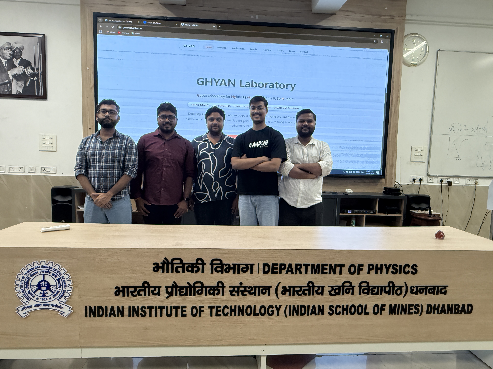
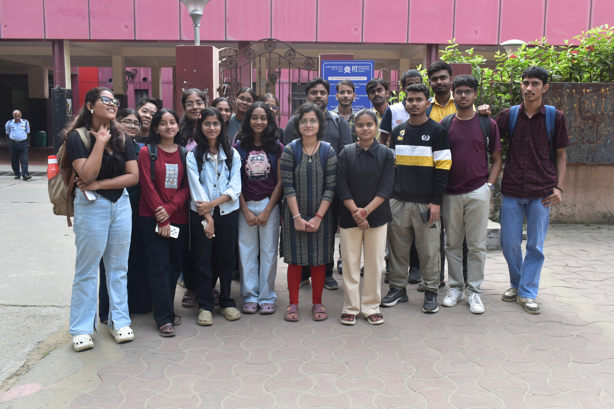
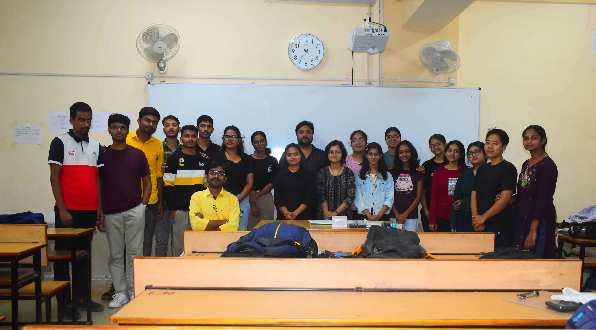
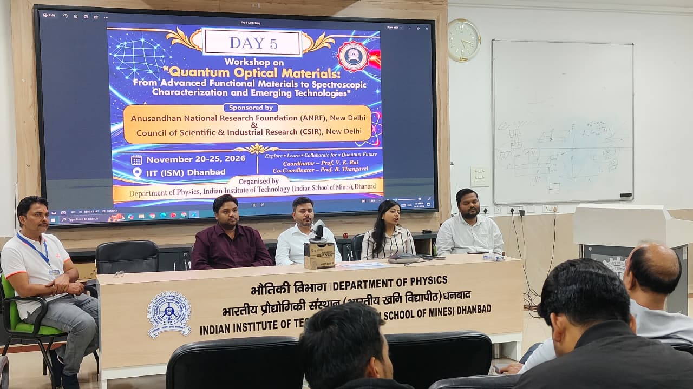

```{=html}
<style>
  #title-block-header { display: none; }
  
  /* Natural body scrolling */
  html { 
    scroll-padding-top: 100px; /* Accounts for floating Quarto navbar */
    scroll-behavior: smooth;
  }
  
  body { 
    background-color: var(--bs-body-bg, #f6f5f0); 
  }
  
  #quarto-content { padding: 0 !important; margin: 0 !important; }
  
  /* Quarto footer styling */
  .nav-footer {
    background-color: var(--bs-body-bg) !important;
    border-top: 1px dashed #e0ddd7;
  }
  
  .snap-container {
    width: 100%;
    max-width: 100%;
    overflow-x: hidden;
  }
  
  /* Full-width, full-height sections */
  .snap-section {
    min-height: calc(100vh - 100px);
    width: 100%;
    display: flex;
    align-items: center;
    justify-content: center;
    padding: 2rem 1.5rem;
    position: relative;
  }
  
  .hero-text {
    max-width: 850px;
    line-height: 1.8;
  }
  
  /* --- Floating Tab --- */
  .floating-tab {
    position: fixed;
    bottom: 40px;
    left: 40px;
    background: #fbfcfb; /* Card background */
    border: 1px solid #e0ddd7;
    padding: 10px 20px 10px 15px;
    border-radius: 50px;
    box-shadow: 0 10px 25px rgba(0,0,0,0.05);
    z-index: 1000;
    display: flex;
    align-items: center;
    gap: 12px;
    text-decoration: none;
    color: #373531;
    transition: all 0.3s ease;
  }
  @media (max-width: 576px) {
    .floating-tab {
      bottom: 20px;
      left: 20px;
      padding: 8px 14px 8px 10px;
    }
  }
  .floating-tab:hover {
    transform: translateY(-5px);
    box-shadow: 0 15px 35px rgba(0,0,0,0.08);
    color: #373531;
    text-decoration: none;
  }
  .floating-icon-wrap {
    background: #c26a4b; /* Primary Accent */
    color: white;
    width: 36px;
    height: 36px;
    border-radius: 50%;
    display: flex;
    align-items: center;
    justify-content: center;
    font-size: 1.1rem;
    box-shadow: 0 4px 10px rgba(0,0,0,0.1);
  }
  .floating-text .eyebrow {
    font-size: 0.7rem;
    font-weight: 700;
    text-transform: uppercase;
    color: #c26a4b;
    letter-spacing: 0.5px;
    line-height: 1;
    margin-bottom: 2px;
  }
  .floating-text .main {
    font-size: 0.95rem;
    font-weight: 700;
    line-height: 1;
  }
  
  /* Utilities for Kinto Theme */
  .text-accent { color: #c26a4b !important; }
  .bg-accent { background-color: #c26a4b !important; color: white !important; }
  .text-muted-foreground { color: #7a7771 !important; }
  .border-subtle { border-color: #e0ddd7 !important; }
</style>

<!-- Floating Bottom Left Tab -->
<a href="contact.html" class="floating-tab">
  <div class="floating-icon-wrap">
    <i class="bi bi-envelope-fill">✉</i>
  </div>
  <div class="floating-text">
    <div class="eyebrow">Open Positions</div>
    <div class="main">Contact PI</div>
  </div>
</a>

<div class="snap-container">

  <!-- Section 1: Hero Banner -->
  <section class="snap-section text-center">
    <div class="container d-flex flex-column justify-content-center align-items-center" style="z-index: 1;">
      
      <h1 class="display-2 fw-bolder mb-3" style="color: #373531; letter-spacing: -0.02em;">GHYAN Laboratory</h1> 
      <h2 class="h3 mb-4 fw-normal" style="color: #7a7771; font-size: 2.5rem"><span class="text-accent fw-bold">G</span>upta Laboratory for <span class="text-accent fw-bold">HY</span>brid Qu<span class="text-accent fw-bold">A</span>ntum Systems & Spi<span class="text-accent fw-bold">N</span>tronics</h2>
      
      <div class="d-inline-block border border-subtle rounded-pill px-4 py-2 mb-4 bg-white shadow-sm">
        <p class="text-uppercase small fw-bold text-accent mb-0" style="letter-spacing: 2px;">
          Spintronics &middot; Orbitronics &middot; Hybrid Quantum Systems &middot; Quantum Sensing
        </p>
      </div>
      
      <p class="lead hero-text mb-5 mx-auto text-muted-foreground">
        Welcome to the GHYAN Laboratory! We explore the spin, orbital, and quantum degrees of freedom in hybrid systems to uncover fundamental phenomena and enable next-generation quantum technologies and energy-efficient AI hardware.
      </p>
      
      <div class="d-flex flex-wrap gap-3 justify-content-center mb-5">
        <a href="research.html" class="btn bg-accent btn-lg rounded-pill px-5 shadow-sm border-0">Explore Our Research</a>
        <a href="contact.html" class="btn btn-outline-dark btn-lg rounded-pill px-5 border-subtle text-muted-foreground">Join GHYAN</a>
      </div>
      
      <p class="fs-5 text-muted-foreground mt-3">
        Department of Physics &middot; Indian Institute of Technology (Indian School of Mines) Dhanbad &middot; India
      </p>
      
    </div>
  </section>

  <!-- Section 2: Welcome (Using existing theme styles) -->
  <section class="snap-section" style="background-color: #fbfcfb;">
    <div class="container py-5">
      <!-- We reuse the .home-layout from your styles.css for a native look -->
      <div class="home-layout" style="margin-top: 0; margin-bottom: 0; min-height: auto;">
        
        <!-- Left Column: Profile -->
        <div class="home-left">
          <div class="profile-img-container" style="border-color: #e0ddd7;">
            
          </div>
          <div class="profile-name" style="color: #373531;">Dr. Rahul Gupta</div>
          <div class="profile-title text-muted-foreground">Assistant Professor</div>
          <div class="profile-title text-muted-foreground">Department of Physics</div>
          <div class="profile-title text-muted-foreground">IIT (ISM) Dhanbad</div>
          
          <div style="margin-top: 0.6rem; margin-bottom: 0.25rem;">
            <a href="mailto:rahulgupta@iitism.ac.in" style="color: #003e6b; font-size: 0.92rem; text-decoration: none; font-weight: 500; display: inline-flex; align-items: center; gap: 0.35rem;">
              <svg width="15" height="15" viewBox="0 0 24 24" fill="none" stroke="currentColor" stroke-width="2"><rect width="20" height="16" x="2" y="4" rx="2"/><path d="m22 7-8.97 5.7a1.94 1.94 0 0 1-2.06 0L2 7"/></svg>
              rahulgupta@iitism.ac.in
            </a>
          </div>
          
          <div class="social-buttons" style="margin-top: 0.85rem; display: flex; flex-wrap: wrap; justify-content: center; gap: 0.45rem;">
            <a href="https://scholar.google.com/citations?user=RXq6sakAAAAJ&hl=en" class="social-btn scholar" target="_blank" rel="noopener noreferrer" title="Google Scholar">
              <svg width="14" height="14" viewBox="0 0 24 24" fill="#4285F4"><path d="M12 24a12 12 0 1 1 0-24 12 12 0 0 1 0 24zm-.354-18.736a.65.65 0 0 0-.292.071L3.896 9.2a.652.652 0 0 0 0 1.144l7.458 3.865a.652.652 0 0 0 .592 0l6.762-3.504v5.42a.652.652 0 1 0 1.304 0v-6.07a.652.652 0 0 0-.356-.582L12.238 5.335a.65.65 0 0 0-.592 0zm.354 7.02l-5.632-2.918 5.632-2.919 5.632 2.919-5.632 2.918zm0 2.133a8.877 8.877 0 0 0-4.372 1.127.652.652 0 1 0 .668 1.122 7.575 7.575 0 0 1 7.408 0 .652.652 0 1 0 .668-1.122 8.877 8.877 0 0 0-4.372-1.127z"/></svg>
              Google Scholar ↗
            </a>
            <a href="https://orcid.org/0000-0001-6523-3161" class="social-btn orcid" target="_blank" rel="noopener noreferrer" title="ORCID">
              <svg width="14" height="14" viewBox="0 0 24 24" fill="#a6ce39"><path d="M12 0C5.372 0 0 5.372 0 12s5.372 12 12 12 12-5.372 12-12S18.628 0 12 0zM7.369 4.378c.525 0 .947.431.947.947s-.422.947-.947.947a.95.95 0 0 1-.948-.947c0-.516.422-.947.948-.947zm-.722 3.038h1.444v10.041H6.647V7.416zm3.562 0h3.9c3.712 0 5.344 2.653 5.344 5.025 0 2.578-2.016 5.016-5.325 5.016h-3.919V7.416zm1.444 1.303v7.444h2.297c3.272 0 4.022-2.484 4.022-3.722 0-2.016-1.284-3.722-4.097-3.722h-2.222z"/></svg>
              ORCID ↗
            </a>
            <a href="https://www.webofscience.com/wos/author/record/IQS-3298-2023" class="social-btn wos" target="_blank" rel="noopener noreferrer" title="Web of Science">
              <svg width="14" height="14" viewBox="0 0 24 24" fill="none" stroke="currentColor" stroke-width="2"><path d="M12 2L2 7l10 5 10-5-10-5zM2 17l10 5 10-5M2 12l10 5 10-5"/></svg>
              Web of Science ↗
            </a>
            <a href="https://www.linkedin.com/in/rahul-gupta-b43218b8/" class="social-btn linkedin" target="_blank" rel="noopener noreferrer" title="LinkedIn">
              <svg width="13" height="13" viewBox="0 0 24 24" fill="currentColor"><path d="M19 3a2 2 0 0 1 2 2v14a2 2 0 0 1-2 2H5a2 2 0 0 1-2-2V5a2 2 0 0 1 2-2h14m-.5 15.5v-5.3a3.26 3.26 0 0 0-3.26-3.26c-.85 0-1.84.52-2.28 1.3v-1.11h-2.79v8.37h2.79v-4.93c0-.77.62-1.4 1.39-1.4a1.4 1.4 0 0 1 1.4 1.4v4.93h2.75M6.88 8.56a1.68 1.68 0 0 0 1.68-1.68c0-.93-.75-1.69-1.68-1.69a1.69 1.69 0 0 0-1.69 1.69c0 .93.76 1.68 1.69 1.68m1.39 9.94v-8.37H5.5v8.37h2.77z"/></svg>
              LinkedIn ↗
            </a>
          </div>
        </div>

        <!-- Right Column: Welcome and Bio -->
        <div class="home-right">
          <h2 class="welcome-title mb-4" style="font-size: 2.5rem; font-weight: 700; color: #373531; letter-spacing: -0.02em;">Welcome to the GHYAN (ज्ञान) Laboratory</h2>
          
          <div class="welcome-text text-muted-foreground" style="font-size: 1.05rem; line-height: 1.7;">
            <p>The GHYAN (ज्ञान) Laboratory (Gupta laboratory for HYbrid quAntum systems and spintroNics) is a research group in the Department of Physics at Indian Institute of Technology-Indian School of Mines (IIT-ISM) Dhanbad.</p>
            
            <p>Our research explores the interplay of quantum degrees of freedom, particularly spin and orbital angular momentum, in thin films, heterostructures, and hybrid systems. We investigate the fundamental mechanisms governing the generation, transport, conversion, and dynamics of quantum angular momentum and translate these concepts toward spintronics, orbitronics, hybrid quantum systems, quantum sensing, and emerging device technologies.</p>
            
            <p>We employ an integrated theoretical, computational, and experimental approach, combining multiphysics and micromagnetic simulations using COMSOL, HFSS, and MuMax with materials development, thin-film fabrication, and electrical, magnetic, and ultrafast characterization.</p>
            
            <p class="mt-4 pt-3 border-top border-subtle" style="color: #373531; font-weight: 500;">
              🎓 We welcome highly motivated PhD students and postdoctoral researchers interested in working at the interface of quantum materials and emerging device technologies.
            </p>
          </div>
          
          <div class="action-buttons mt-4">
            <a href="research.html" class="action-btn bg-accent text-white border-0">Research Areas</a>
            <a href="publications.html" class="action-btn" style="border-color: #e0ddd7; color: #7a7771;">Publications</a>
            <a href="people.html" class="action-btn" style="border-color: #e0ddd7; color: #7a7771;">Lab Members</a>
          </div>
        </div>

      </div>
    </div>
  </section>

  <!-- Section 3: Gallery -->
  <section class="snap-section">
    <div class="container text-center">
      <h2 class="display-6 fw-bold mb-3" style="color: #373531; letter-spacing: -0.02em;">Gallery</h2>
      <p class="text-muted-foreground mb-5 fs-5">
        Glimpses from our lab, events, and research activities.
      </p>
      
      <!-- Working Bootstrap Carousel -->
      <div class="row g-4 justify-content-center mx-auto" style="max-width: 1000px;">
        <div class="col-md-10">
          <div id="galleryCarousel" class="carousel slide carousel-fade rounded-4 shadow-sm overflow-hidden border border-subtle" data-bs-ride="carousel">
            <div class="carousel-indicators">
              <button type="button" data-bs-target="#galleryCarousel" data-bs-slide-to="0" class="active" aria-current="true" aria-label="Slide 1"></button>
              <button type="button" data-bs-target="#galleryCarousel" data-bs-slide-to="1" aria-label="Slide 2"></button>
              <button type="button" data-bs-target="#galleryCarousel" data-bs-slide-to="2" aria-label="Slide 3"></button>
            </div>
            <div class="carousel-inner">
              <div class="carousel-item active" data-bs-interval="4000">
                
                <div class="carousel-caption d-none d-md-block bg-dark bg-opacity-50 rounded-3 p-3 mb-4 mx-4">
                  <h5 class="text-white fw-bold mb-1">Group Members of GHYAN Laboratory</h5>
                  <p class="text-light mb-0">Exploring spin and quantum degrees of freedom at IIT (ISM) Dhanbad.</p>
                </div>
              </div>
              <div class="carousel-item" data-bs-interval="4000">
                
                <div class="carousel-caption d-none d-md-block bg-dark bg-opacity-50 rounded-3 p-3 mb-4 mx-4">
                  <h5 class="text-white fw-bold mb-1">Class of Monsoon Semester 2026</h5>
                  <p class="text-light mb-0">Course: Foundation of Physics &bull; IIT (ISM) Dhanbad</p>
                </div>
              </div>
              <div class="carousel-item" data-bs-interval="4000">
                
                <div class="carousel-caption d-none d-md-block bg-dark bg-opacity-50 rounded-3 p-3 mb-4 mx-4">
                  <h5 class="text-white fw-bold mb-1">Class of Monsoon Semester 2026</h5>
                  <p class="text-light mb-0">Course: Foundation of Physics &bull; IIT (ISM) Dhanbad</p>
                </div>
              </div>
               <div class="carousel-item" data-bs-interval="4000">
                
                <div class="carousel-caption d-none d-md-block bg-dark bg-opacity-50 rounded-3 p-3 mb-4 mx-4">
                  <h5 class="text-white fw-bold mb-1">Expert Insights on Quantum Optical Materials by Our Group Leader, Dr. Rahul Gupta</h5></h5>
                  <p class="text-light mb-0">Invited Panelist &bull; Workshop on Quantum Optical Materials, IIT (ISM) Dhanbad</p>
                </div>
              </div>
            </div>
            <button class="carousel-control-prev" type="button" data-bs-target="#galleryCarousel" data-bs-slide="prev">
              <span class="carousel-control-prev-icon" aria-hidden="true"></span>
              <span class="visually-hidden">Previous</span>
            </button>
            <button class="carousel-control-next" type="button" data-bs-target="#galleryCarousel" data-bs-slide="next">
              <span class="carousel-control-next-icon" aria-hidden="true"></span>
              <span class="visually-hidden">Next</span>
            </button>
          </div>
        </div>
      </div>
      
    </div>
  </section>

</div>
```
