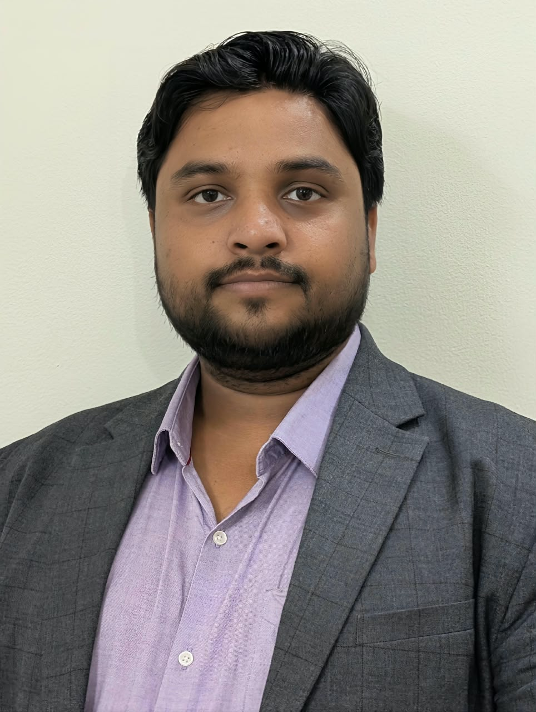
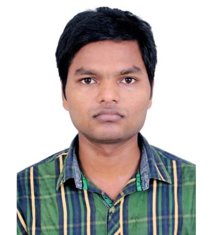
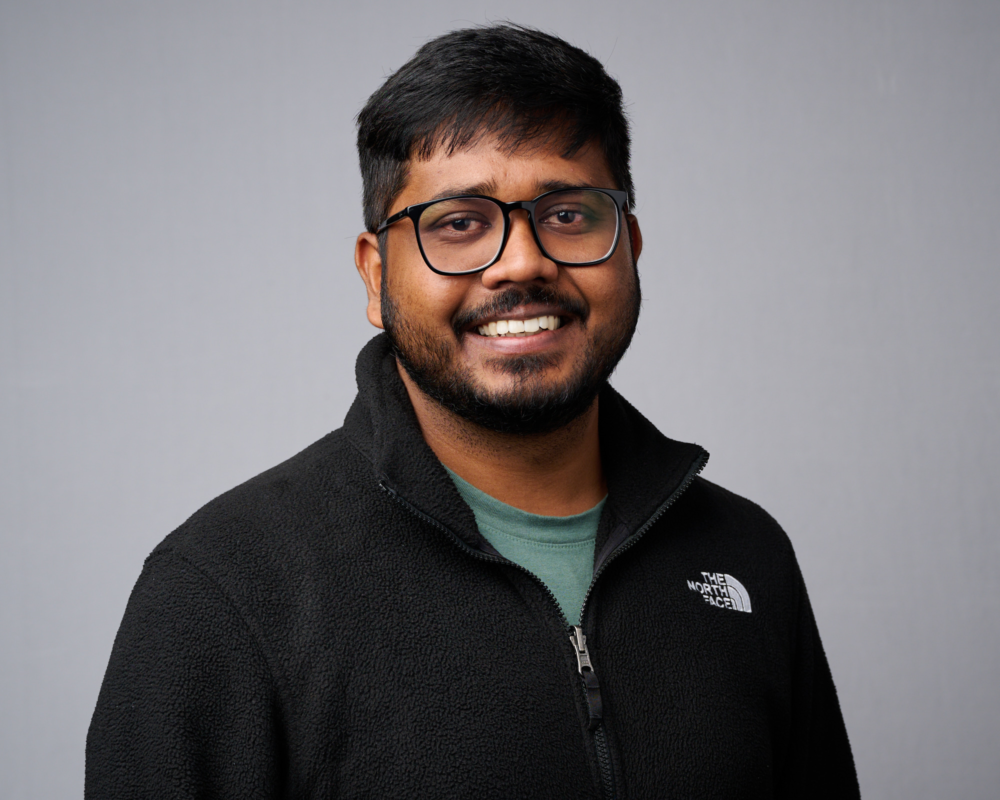
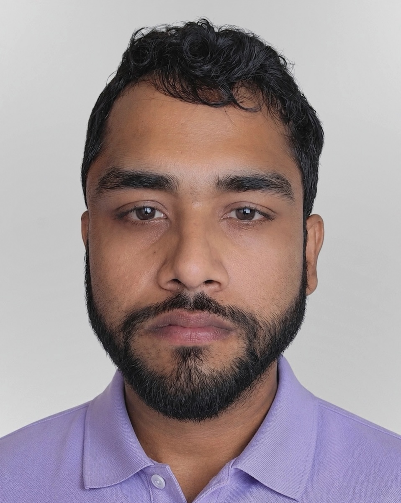
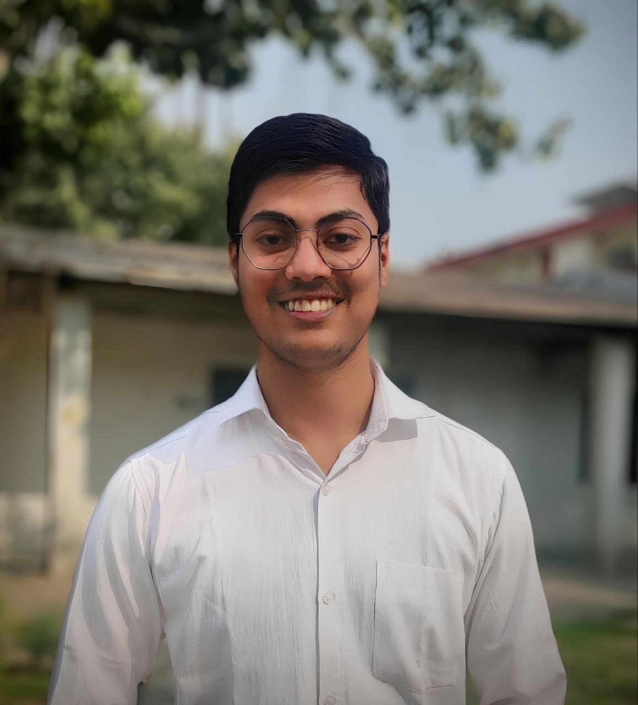

```{=html}
<meta http-equiv="Cache-Control" content="no-cache, no-store, must-revalidate">
<meta http-equiv="Pragma" content="no-cache">
<meta http-equiv="Expires" content="0">

<style>
/* Vertical sequence of rows: 1 member per row */
.team-grid {
  display: flex !important;
  flex-direction: column !important;
  gap: 1.75rem !important;
}

.member-card {
  display: flex !important;
  flex-direction: row !important;
  align-items: flex-start !important;
  background: #ffffff;
  border-radius: 14px;
  border: 1px solid #e2e8f0;
  padding: 1.75rem 2rem;
  box-shadow: 0 4px 18px rgba(0, 0, 0, 0.03);
  gap: 1.75rem;
  transition: transform 0.25s ease, box-shadow 0.25s ease, border-color 0.25s ease;
}

.member-card:hover {
  transform: translateY(-3px);
  box-shadow: 0 10px 28px rgba(0, 0, 0, 0.08);
  border-color: #cbd5e1;
}

.member-photo {
  width: 130px !important;
  height: 130px !important;
  min-width: 130px !important;
  padding-bottom: 0 !important;
  margin: 0 !important;
  position: relative;
  border: 3px solid #f1f5f9;
  border-radius: 50% !important;
  overflow: hidden;
  box-shadow: 0 4px 12px rgba(0, 0, 0, 0.08);
  flex-shrink: 0;
}

.member-photo img {
  position: absolute;
  top: 0;
  left: 0;
  width: 100% !important;
  height: 100% !important;
  object-fit: cover;
  border-radius: 50%;
}

.member-info {
  padding: 0 !important;
  display: flex;
  flex-direction: column;
  flex: 1;
}

.member-info h3 {
  margin: 0 0 0.25rem 0;
  font-size: 1.35rem;
  font-weight: 700;
  color: #1e293b;
  text-align: left !important;
}

.member-position {
  font-size: 0.95rem;
  color: #2563eb;
  font-weight: 600;
  margin: 0 0 0.2rem 0;
  text-align: left !important;
}

.member-department {
  font-size: 0.86rem;
  color: #64748b;
  margin: 0 0 0.75rem 0;
  text-align: left !important;
  line-height: 1.35;
}

.member-bio {
  font-size: 0.92rem;
  color: #475569;
  line-height: 1.65;
  margin: 0 0 1rem 0;
  text-align: left !important;
}

.member-tags {
  display: flex;
  flex-wrap: wrap;
  gap: 0.4rem;
  margin-bottom: 1rem;
  justify-content: flex-start !important;
}

.member-tag {
  font-size: 0.78rem;
  font-weight: 600;
  padding: 0.25rem 0.65rem;
  border-radius: 12px;
  background: #f1f5f9;
  color: #334155;
  border: 1px solid #e2e8f0;
  line-height: 1.3;
}

.member-links {
  display: flex;
  flex-wrap: wrap;
  gap: 1rem;
  align-items: center;
  justify-content: flex-start !important;
  padding-top: 0.75rem;
  border-top: 1px dashed #e2e8f0;
  margin-top: 0 !important;
}

.member-link-btn {
  display: inline-flex;
  align-items: center;
  gap: 0.4rem;
  font-size: 0.88rem;
  font-weight: 600;
  color: #0284c7 !important;
  text-decoration: none !important;
  transition: color 0.2s ease;
}

.member-link-btn:hover {
  color: #0369a1 !important;
  text-decoration: underline !important;
}

.leader-sidebar {
  width: 100%;
  max-width: 440px;
  margin: 0 auto;
}

@media (min-width: 992px) {
  .leader-sidebar {
    flex: 0 0 350px !important;
    max-width: 350px !important;
    margin: 0 !important;
    align-self: flex-start !important;
  }
}

.leader-section-title {
  font-size: 0.82rem;
  font-weight: 700;
  text-transform: uppercase;
  letter-spacing: 0.06em;
  color: #1e293b;
  margin-bottom: 0.85rem;
  display: flex;
  align-items: center;
}

.leader-timeline {
  display: flex;
  flex-direction: column;
  gap: 0.95rem;
  position: relative;
  padding-left: 0.95rem;
  border-left: 2px solid #e2e8f0;
  margin-left: 0.35rem;
  text-align: left;
}

.leader-timeline-item {
  position: relative;
  text-align: left;
}

.leader-timeline-item::before {
  content: "";
  position: absolute;
  left: calc(-0.95rem - 5px);
  top: 5px;
  width: 8px;
  height: 8px;
  border-radius: 50%;
  background: #2563eb;
  border: 2px solid #ffffff;
  box-shadow: 0 0 0 1px #93c5fd;
}

.timeline-period {
  font-size: 0.72rem;
  font-weight: 700;
  color: #64748b;
  text-transform: uppercase;
  letter-spacing: 0.03em;
  margin-bottom: 0.2rem;
}

.timeline-role {
  font-size: 0.88rem;
  font-weight: 600;
  color: #0f172a;
  line-height: 1.35;
  margin-bottom: 0.2rem;
}

.timeline-specialization {
  font-size: 0.78rem;
  color: #475569;
  line-height: 1.3;
  margin-bottom: 0.2rem;
}

.timeline-inst {
  font-size: 0.8rem;
  color: #475569;
  line-height: 1.35;
}

.timeline-inst strong {
  color: #1e293b;
  font-weight: 600;
}

.badge-grade {
  display: inline-block;
  font-size: 0.7rem;
  font-weight: 600;
  padding: 0.1rem 0.4rem;
  border-radius: 6px;
  background: #eff6ff;
  color: #1d4ed8;
  border: 1px solid #dbeafe;
  margin-left: 0.25rem;
  vertical-align: 1px;
}

@media (max-width: 700px) {
  .member-card {
    flex-direction: column !important;
    align-items: center !important;
    text-align: center;
    padding: 1.5rem;
  }
  .member-photo {
    margin: 0 auto 1rem auto !important;
  }
  .member-info h3,
  .member-position,
  .member-department,
  .member-bio {
    text-align: center !important;
  }
  .member-tags,
  .member-links {
    justify-content: center !important;
  }
}
</style>

<div class="people-page">

  <!-- TEAM LEADER SIDEBAR -->
  <div class="leader-sidebar">
    <div class="leader-sticky">
      <div class="leader-label">TEAM LEADER</div>
      <div class="leader-photo">
        
      </div>
      <h2>Dr. Rahul Gupta</h2>
      <p class="leader-role">Assistant Professor</p>
      <div class="leader-divider"></div>
      <p class="leader-bio">
        Research interests include magnetism, spin-orbitronics, terahertz spintronics, quantum magnetic devices, and NV sensing.
      </p>
      <div class="leader-details">
        <p><span>Research</span> Spintronics & Magnetism</p>
        <p><span>Department</span> Department of Physics</p>
        <p><span>Institution</span> IIT (ISM) Dhanbad</p>
      </div>
      <a class="leader-email" href="mailto:rahulgupta@iitism.ac.in">
        Contact the PI ↗
      </a>
      <div class="social-buttons" style="margin-top: 1rem; display: flex; flex-wrap: wrap; justify-content: center; gap: 0.45rem;">
        <a href="https://scholar.google.com/citations?user=RXq6sakAAAAJ&hl=en" class="social-btn scholar" target="_blank" rel="noopener noreferrer" title="Google Scholar">
          <svg width="14" height="14" viewBox="0 0 24 24" fill="#4285F4"><path d="M12 24a12 12 0 1 1 0-24 12 12 0 0 1 0 24zm-.354-18.736a.65.65 0 0 0-.292.071L3.896 9.2a.652.652 0 0 0 0 1.144l7.458 3.865a.652.652 0 0 0 .592 0l6.762-3.504v5.42a.652.652 0 1 0 1.304 0v-6.07a.652.652 0 0 0-.356-.582L12.238 5.335a.65.65 0 0 0-.592 0zm.354 7.02l-5.632-2.918 5.632-2.919 5.632 2.919-5.632 2.918zm0 2.133a8.877 8.877 0 0 0-4.372 1.127.652.652 0 1 0 .668 1.122 7.575 7.575 0 0 1 7.408 0 .652.652 0 1 0 .668-1.122 8.877 8.877 0 0 0-4.372-1.127z"/></svg>
          Google Scholar ↗
        </a>
        <a href="https://orcid.org/0000-0001-6523-3161" class="social-btn orcid" target="_blank" rel="noopener noreferrer" title="ORCID">
          <svg width="14" height="14" viewBox="0 0 24 24" fill="#a6ce39"><path d="M12 0C5.372 0 0 5.372 0 12s5.372 12 12 12 12-5.372 12-12S18.628 0 12 0zM7.369 4.378c.525 0 .947.431.947.947s-.422.947-.947.947a.95.95 0 0 1-.948-.947c0-.516.422-.947.948-.947zm-.722 3.038h1.444v10.041H6.647V7.416zm3.562 0h3.9c3.712 0 5.344 2.653 5.344 5.025 0 2.578-2.016 5.016-5.325 5.016h-3.919V7.416zm1.444 1.303v7.444h2.297c3.272 0 4.022-2.484 4.022-3.722 0-2.016-1.284-3.722-4.097-3.722h-2.222z"/></svg>
          ORCID ↗
        </a>
        <a href="https://www.webofscience.com/wos/author/record/IQS-3298-2023" class="social-btn wos" target="_blank" rel="noopener noreferrer" title="Web of Science">
          <svg width="14" height="14" viewBox="0 0 24 24" fill="none" stroke="currentColor" stroke-width="2"><path d="M12 2L2 7l10 5 10-5-10-5zM2 17l10 5 10-5M2 12l10 5 10-5"/></svg>
          Web of Science ↗
        </a>
        <a href="https://www.linkedin.com/in/rahul-gupta-b43218b8/" class="social-btn linkedin" target="_blank" rel="noopener noreferrer" title="LinkedIn">
          <svg width="13" height="13" viewBox="0 0 24 24" fill="currentColor" style="vertical-align: -1px; margin-right: 3px;"><path d="M19 3a2 2 0 0 1 2 2v14a2 2 0 0 1-2 2H5a2 2 0 0 1-2-2V5a2 2 0 0 1 2-2h14m-.5 15.5v-5.3a3.26 3.26 0 0 0-3.26-3.26c-.85 0-1.84.52-2.28 1.3v-1.11h-2.79v8.37h2.79v-4.93c0-.77.62-1.4 1.39-1.4a1.4 1.4 0 0 1 1.4 1.4v4.93h2.75M6.88 8.56a1.68 1.68 0 0 0 1.68-1.68c0-.93-.75-1.69-1.68-1.69a1.69 1.69 0 0 0-1.69 1.69c0 .93.76 1.68 1.69 1.68m1.39 9.94v-8.37H5.5v8.37h2.77z"/></svg>
          LinkedIn ↗
        </a>
      </div>

      <div class="leader-divider" style="margin: 1.5rem 0 1.25rem 0;"></div>

      <!-- WORK EXPERIENCE -->
      <div class="leader-section-title">
        <svg width="15" height="15" viewBox="0 0 24 24" fill="none" stroke="currentColor" stroke-width="2.2" style="color: #2563eb; vertical-align: -2px; margin-right: 6px;"><rect width="20" height="14" x="2" y="7" rx="2" ry="2"/><path d="M16 21V5a2 2 0 0 0-2-2h-4a2 2 0 0 0-2 2v16"/></svg>
        Work Experience
      </div>

      <div class="leader-timeline">
        <div class="leader-timeline-item">
          <div class="timeline-period">July 2026 – Present</div>
          <div class="timeline-role">Assistant Professor</div>
          <div class="timeline-inst">Department of Physics, <strong>Indian Institute of Technology (Indian School of Mines) Dhanbad</strong>, Jharkhand, India</div>
        </div>

        <div class="leader-timeline-item">
          <div class="timeline-period">Sep 2024 – July 2026</div>
          <div class="timeline-role">Swedish Research Council Postdoctoral Researcher</div>
          <div class="timeline-inst">Department of Physics, <strong>University of Gothenburg</strong>, Sweden, <strong>University of South Florida</strong>, USA and <strong>University of Illinois Urbana-Champaign</strong>, USA</div>
        </div>

        <div class="leader-timeline-item">
          <div class="timeline-period">Aug 2022 – Aug 2024</div>
          <div class="timeline-role">Postdoctoral Researcher</div>
          <div class="timeline-inst">Institute of Physics, <strong>Johannes Gutenberg University of Mainz</strong>, Germany</div>
        </div>

        <div class="leader-timeline-item">
          <div class="timeline-period">Jan 2022 – Jul 2022</div>
          <div class="timeline-role">Research Associate</div>
          <div class="timeline-inst">Department of Physics, <strong>Uppsala University</strong>, Sweden</div>
        </div>
      </div>

      <div class="leader-divider" style="margin: 1.5rem 0 1.25rem 0;"></div>

      <!-- EDUCATION -->
      <div class="leader-section-title">
        <svg width="15" height="15" viewBox="0 0 24 24" fill="none" stroke="currentColor" stroke-width="2.2" style="color: #2563eb; vertical-align: -2px; margin-right: 6px;"><path d="M22 10v6M2 10l10-5 10 5-10 5z"/><path d="M6 12v5c3 3 9 3 12 0v-5"/></svg>
        Education
      </div>

      <div class="leader-timeline">
        <div class="leader-timeline-item">
          <div class="timeline-period">Jun 2017 – Dec 2021</div>
          <div class="timeline-role">Doctor of Philosophy in Solid State Physics</div>
          <div class="timeline-specialization">Department of Materials Science and Engineering</div>
          <div class="timeline-inst"><strong>Ångström Laboratory, Uppsala University</strong>, Sweden</div>
        </div>

        <div class="leader-timeline-item">
          <div class="timeline-period">May 2017 – Jul 2015</div>
          <div class="timeline-role">Master of Technology in Solid State Materials</div>
          <div class="timeline-inst"><strong>Indian Institute of Technology (IIT) Delhi</strong>, India</div>
        </div>

        <div class="leader-timeline-item">
          <div class="timeline-period">Jun 2015 – Jun 2013</div>
          <div class="timeline-role">Master of Science in Physics</div>
          <div class="timeline-specialization">Specialization in Condensed Matter Physics</div>
          <div class="timeline-inst"><strong>Aligarh Muslim University</strong>, India</div>
        </div>

        <div class="leader-timeline-item">
          <div class="timeline-period">Jun 2010 – May 2013</div>
          <div class="timeline-role">Bachelor of Science</div>
          <div class="timeline-inst"><strong>M. J. P. Rohilkhand University</strong>, India</div>
        </div>
      </div>
    </div>
  </div>

  <!-- TEAM MEMBERS -->
  <div class="team-section">
    <div class="team-heading">
      <div>
        <h2>Team Members</h2>
      </div>
    </div>

    <div class="team-grid">

      <!-- Member 1: Dr. Amar Kumar -->
      <div class="member-card">
        <div class="member-photo">
          
        </div>
        <div class="member-info">
          <h3>Dr. Amar Kumar</h3>
          <p class="member-position">Centenary Early Faculty Fellow</p>
          <p class="member-department">Department of Physics &bull; IIT (ISM) Dhanbad</p>
          <p class="member-bio">
            Dr. Amar Kumar received his Ph.D. from IIT Delhi (2026). His research in GHYAN Lab focuses on computational investigation of multifunctional materials (Heusler alloys, perovskites, altermagnets) for next-generation spintronic memories, neuromorphic computing, and AI hardware.
          </p>
          <div class="member-tags">
            <span class="member-tag">Altermagnetic Materials</span>
            <span class="member-tag">Heusler Alloys</span>
            <span class="member-tag">Density Functional Theory</span>
            <span class="member-tag">Spintronic Memories &amp; AI Hardware</span>
            <span class="member-tag">Quantum Computing</span>
          </div>
          <div class="member-links">
            <a class="member-link-btn" href="mailto:8048@iitism.ac.in">
              <svg width="14" height="14" viewBox="0 0 24 24" fill="none" stroke="currentColor" stroke-width="2"><rect width="20" height="16" x="2" y="4" rx="2"/><path d="m22 7-8.97 5.7a1.94 1.94 0 0 1-2.06 0L2 7"/></svg>
              Email ↗
            </a>
            <a class="member-link-btn" href="https://scholar.google.com.py/citations?user=Jg8G82YAAAAJ&hl=th" target="_blank" rel="noopener noreferrer">
              <svg width="14" height="14" viewBox="0 0 24 24" fill="#4285F4"><path d="M12 24a12 12 0 1 1 0-24 12 12 0 0 1 0 24zm-.354-18.736a.65.65 0 0 0-.292.071L3.896 9.2a.652.652 0 0 0 0 1.144l7.458 3.865a.652.652 0 0 0 .592 0l6.762-3.504v5.42a.652.652 0 1 0 1.304 0v-6.07a.652.652 0 0 0-.356-.582L12.238 5.335a.65.65 0 0 0-.592 0zm.354 7.02l-5.632-2.918 5.632-2.919 5.632 2.919-5.632 2.918zm0 2.133a8.877 8.877 0 0 0-4.372 1.127.652.652 0 1 0 .668 1.122 7.575 7.575 0 0 1 7.408 0 .652.652 0 1 0 .668-1.122 8.877 8.877 0 0 0-4.372-1.127z"/></svg>
              Google Scholar ↗
            </a>
          </div>
        </div>
      </div>

      <!-- Member 2: Dr. Chandan Vishwakarma (Visiting Scientist, after Amar) -->
      <div class="member-card">
        <div class="member-photo">
          
        </div>
        <div class="member-info">
          <h3>Dr. Chandan Vishwakarma</h3>
          <p class="member-position">Visiting Scientist</p>
          <p class="member-department">Postdoctoral Researcher, UC Santa Barbara (UCSB)</p>
          <p class="member-bio">
            Dr. Chandan Kumar Vishwakarma received his Ph.D. from IIT Delhi and is a postdoctoral researcher at UC Santa Barbara (UCSB). His research focuses on computational condensed matter physics, first-principles DFT calculations, and solid-state qubits including NV centers in diamond.
          </p>
          <div class="member-tags">
            <span class="member-tag">First Principles Calculations</span>
            <span class="member-tag">Density Functional Theory</span>
            <span class="member-tag">NV sensing</span>
          </div>
          <div class="member-links">
            <a class="member-link-btn" href="https://scholar.google.com/citations?user=CDpywfwAAAAJ&hl=en" target="_blank" rel="noopener noreferrer">
              <svg width="14" height="14" viewBox="0 0 24 24" fill="#4285F4"><path d="M12 24a12 12 0 1 1 0-24 12 12 0 0 1 0 24zm-.354-18.736a.65.65 0 0 0-.292.071L3.896 9.2a.652.652 0 0 0 0 1.144l7.458 3.865a.652.652 0 0 0 .592 0l6.762-3.504v5.42a.652.652 0 1 0 1.304 0v-6.07a.652.652 0 0 0-.356-.582L12.238 5.335a.65.65 0 0 0-.592 0zm.354 7.02l-5.632-2.918 5.632-2.919 5.632 2.919-5.632 2.918zm0 2.133a8.877 8.877 0 0 0-4.372 1.127.652.652 0 1 0 .668 1.122 7.575 7.575 0 0 1 7.408 0 .652.652 0 1 0 .668-1.122 8.877 8.877 0 0 0-4.372-1.127z"/></svg>
              Google Scholar ↗
            </a>
          </div>
        </div>
      </div>

      <!-- Member 3: Aniruddha Rana -->
      <div class="member-card">
        <div class="member-photo">
          
        </div>
        <div class="member-info">
          <h3>Aniruddha Rana</h3>
          <p class="member-position">PhD Researcher</p>
          <p class="member-department">Department of Physics &bull; IIT (ISM) Dhanbad</p>
          <p class="member-bio">
            Aniruddha completed his Master's from Jadavpur University. He is conducting experimental and computational research in condensed matter physics, focusing on spin-orbit torque (SOT) phenomena, thin-film heterostructures, and device engineering.
          </p>
          <div class="member-tags">
            <span class="member-tag">Spin-Orbitronics</span>
          </div>
          <div class="member-links">
            <a class="member-link-btn" href="mailto:26dr0062@iitism.ac.in">
              <svg width="14" height="14" viewBox="0 0 24 24" fill="none" stroke="currentColor" stroke-width="2"><rect width="20" height="16" x="2" y="4" rx="2"/><path d="m22 7-8.97 5.7a1.94 1.94 0 0 1-2.06 0L2 7"/></svg>
              Email ↗
            </a>
          </div>
        </div>
      </div>

      <!-- Member 4: Aditya Kumar -->
      <div class="member-card">
        <div class="member-photo">
          
        </div>
        <div class="member-info">
          <h3>Aditya Kumar</h3>
          <p class="member-position">MSc Student</p>
          <p class="member-department">Department of Physics &bull; IIT (ISM) Dhanbad</p>
          <p class="member-bio">
            Aditya completed his Bachelor's from the University of Delhi. He is engaged in master's thesis research exploring high-frequency and microwave electromagnetic design for advanced spintronic devices and quantum systems.
          </p>
          <div class="member-tags">
            <span class="member-tag">Desiging of resonator/antenna for spin-orbitronic and quantum technology</span>
          </div>
          <div class="member-links">
            <a class="member-link-btn" href="mailto:26ms0010@iitism.ac.in">
              <svg width="14" height="14" viewBox="0 0 24 24" fill="none" stroke="currentColor" stroke-width="2"><rect width="20" height="16" x="2" y="4" rx="2"/><path d="m22 7-8.97 5.7a1.94 1.94 0 0 1-2.06 0L2 7"/></svg>
              Email ↗
            </a>
          </div>
        </div>
      </div>

    </div>
  </div>

</div>
```
