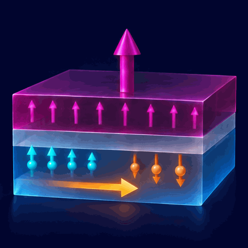

```{=html}
<div style="text-align: center; margin-bottom: 2rem;">
  <p style="font-size: 1.25rem; color: #555; max-width: 820px; margin: 0 auto 1.5rem auto; line-height: 1.6;">
    The GHYAN lab explores the intersection of fundamental quantum physics and next-generation device applications, focusing on spin and orbital angular momentum in thin films, 2D heterostructures, and nanodevices.
  </p>

  <div class="section-jump-nav">
    <a href="#research-areas" class="section-jump-link">
      <svg width="16" height="16" viewBox="0 0 24 24" fill="none" stroke="currentColor" stroke-width="2"><circle cx="12" cy="12" r="10"/><path d="m9 12 2 2 4-4"/></svg>
      Research Areas
    </a>
    <a href="#research-grants" class="section-jump-link">
      <svg width="16" height="16" viewBox="0 0 24 24" fill="none" stroke="currentColor" stroke-width="2"><path d="M12 2v20M17 5H9.5a3.5 3.5 0 0 0 0 7h5a3.5 3.5 0 0 1 0 7H6"/></svg>
      Research Grants &amp; Funding
    </a>
    <a href="#collaborations" class="section-jump-link">
      <svg width="16" height="16" viewBox="0 0 24 24" fill="none" stroke="currentColor" stroke-width="2"><circle cx="18" cy="5" r="3"/><circle cx="6" cy="12" r="3"/><circle cx="18" cy="19" r="3"/><line x1="8.59" y1="13.51" x2="15.42" y2="17.49"/><line x1="15.41" y1="6.51" x2="8.59" y2="10.49"/></svg>
      Collaborations
    </a>
  </div>
</div>
```

<hr style="margin: 2rem auto 3rem auto; border: 0; border-top: 1px solid #eaeaea; max-width: 900px;">

<!-- ======================================================== -->
<!-- SECTION 1: RESEARCH AREAS                               -->
<!-- ======================================================== -->

<div id="research-areas" class="research-section-header">
  <h2>Research Areas</h2>
  <p>Core experimental thrust areas investigating quantum angular momentum, ultrafast dynamics, and device physics</p>
</div>

:::: {.research-row}
::: {.research-text}
### Magnetism &amp; Spintronics
We study the fundamental magnetic properties of novel materials and how electron spin can be utilized for energy-efficient memory and logic devices. By understanding spin transport, spin-orbit torque (SOT), and magnetization dynamics, we aim to design next-generation magnetic RAM (SOT-MRAM) and spin-logic architectures that drastically reduce standby and switching power consumption.

```{=html}
<div class="research-pubs">
  <div class="research-pubs-heading">Key Publications</div>
  <ul class="research-pubs-list">
    <li class="research-pub-item">
      <a href="https://doi.org/10.1038/s41467-024-55437-x" target="_blank" rel="noopener noreferrer">
        Harnessing orbital Hall effect in spin-orbit torque MRAM ↗
      </a>
      <div class="research-pub-journal">Nature Communications 16, 130 (2025)</div>
    </li>
    <li class="research-pub-item">
      <a href="https://doi.org/10.1021/acsnano.3c10649" target="_blank" rel="noopener noreferrer">
        Strong In-Plane Magnetization and Spin Polarization in CFGT/Graphene Heterostructure Spin-Valve ↗
      </a>
      <div class="research-pub-journal">ACS Nano 18 (7), 5240–5248 (2024)</div>
    </li>
    <li class="research-pub-item">
      <a href="https://doi.org/10.1063/5.0025318" target="_blank" rel="noopener noreferrer">
        Emergence of spin–orbit torques in 2D transition metal dichalcogenides: A status update ↗
      </a>
      <div class="research-pub-journal">Applied Physics Reviews 7, 041312 (2020)</div>
    </li>
  </ul>
</div>
```
:::
::: {.research-image}

:::
::::

:::: {.research-row}
::: {.research-text}
### Orbitronics
Beyond the spin degree of freedom, orbital angular momentum offers an exciting, energy-efficient dimension for information processing. We investigate orbitally-driven transport phenomena, including the orbital Hall effect (OHE) and orbital Rashba-Edelstein effect, in light metals (such as Ru, Cr, etc.) and transition metal oxides, unlocking pathways for high-efficiency torque generation without relying on heavy or scarce elements.

```{=html}
<div class="research-pubs">
  <div class="research-pubs-heading">Key Publications</div>
  <ul class="research-pubs-list">
    <li class="research-pub-item">
      <a href="https://doi.org/10.1021/acs.nanolett.5c02641" target="_blank" rel="noopener noreferrer">
        Identification of orbital pumping from spin pumping and rectification effects ↗
      </a>
      <div class="research-pub-journal">Nano Letters 25 (36), 13462–13467 (2025)</div>
    </li>
    <li class="research-pub-item">
      <a href="https://arxiv.org/abs/2508.16339" target="_blank" rel="noopener noreferrer">
        Itinerant orbital Hall effect mechanism leading to large negative orbital torques from light metal vanadium ↗
      </a>
      <div class="research-pub-journal">arXiv:2508.16339 (2025)</div>
    </li>
    <li class="research-pub-item">
      <a href="https://doi.org/10.1021/acs.nanolett.4c06056" target="_blank" rel="noopener noreferrer">
        Nonreciprocity in magnon mediated charge-spin-orbital current interconversion ↗
      </a>
      <div class="research-pub-journal">Nano Letters 25 (8), 3247–3252 (2025)</div>
    </li>
  </ul>
</div>
```
:::
::: {.research-image}

:::
::::

:::: {.research-row}
::: {.research-text}
### Terahertz Spintronics
Exploring the generation, manipulation, and detection of terahertz (THz) radiation using ultrafast spintronic heterostructures. By exploiting inverse spin and orbital Hall effects, anomalous Hall phenomena, we develop ultra-broadband, low-cost spintronic THz emitters (STEs) for high-speed wireless communication, radar, and non-destructive spectroscopic imaging.

```{=html}
<div class="research-pubs">
  <div class="research-pubs-heading">Key Publications</div>
  <ul class="research-pubs-list">
        <li class="research-pub-item">
      <a href="https://arxiv.org/abs/2401.10123" target="_blank" rel="noopener noreferrer">
        Terahertz emission from β-W/CoFe epitaxial spintronic emitters ↗
      </a>
      <div class="research-pub-journal">arXiv:2401.10123 (2024) (accepted in Scientific Reports)</div>
    </li>
    <li class="research-pub-item">
      <a href="https://doi.org/10.1038/s41598-023-33143-w" target="_blank" rel="noopener noreferrer">
        Direct evidence of terahertz emission arising from anomalous Hall effect ↗
      </a>
      <div class="research-pub-journal">Scientific Reports 13, 5988 (2023)</div>
    </li>
        <li class="research-pub-item">
      <a href="https://doi.org/10.1002/adom.202001987" target="_blank" rel="noopener noreferrer">
        Co2FeAl Full Heusler Compound Based Spintronic Terahertz Emitter ↗
      </a>
      <div class="research-pub-journal">Advanced Optical Materials 9 (10), 2001987 (2021)</div>
    </li>
  </ul>
</div>
```
:::
::: {.research-image}

:::
::::

:::: {.research-row}
::: {.research-text}
### Quantum Sensing (NV Sensing)
We aim to utilize nitrogen-vacancy (NV) diamond center magnetometry and atomic-scale quantum sensors to non-invasively probe nanoscale spin configurations, stray magnetic fields, and spin currents with high spatial resolution and sensitivity. By integrating NV center quantum defects with magnetic heterostructures, 2D quantum materials, and spintronic devices, we investigate local spin-orbit torque switching, magnon dynamics, and topological spin textures (such as domain walls and skyrmions) from cryogenic to room temperatures.

```{=html}
<div class="research-pubs">
  <div class="research-pubs-heading">Key Publications in Quantum-Enabled Spintronic Sensing</div>
  <ul class="research-pubs-list">
    <li class="research-pub-item">
      <a href="https://doi.org/10.1002/adfm.202600059" target="_blank" rel="noopener noreferrer">
        Three‐Dimensional Anomalous Hall Sensing Enabled By Spin–Orbit Torque Driven Domain Reconfiguration ↗
      </a>
      <div class="research-pub-journal">Advanced Functional Materials 36 (70), 2600059 (2026)</div>
    </li>
    <li class="research-pub-item">
      <a href="https://doi.org/10.1103/PhysRevApplied.20.044079" target="_blank" rel="noopener noreferrer">
        Single-device offset-free magnetic field sensing with tunable sensitivity and linear range ↗
      </a>
      <div class="research-pub-journal">Physical Review Applied 20, 044079 (2023)</div>
    </li>
  </ul>
</div>
```
:::
::: {.research-image}

:::
::::

<hr style="margin: 4.5rem auto 3rem auto; border: 0; border-top: 1px solid #eaeaea; max-width: 900px;">

<!-- ======================================================== -->
<!-- SECTION 2: RESEARCH GRANTS AND FUNDING                   -->
<!-- ======================================================== -->

<div id="research-grants" class="research-section-header">
  <h2>Research Grants and Funding</h2>
  <p>External and institutional sponsored research projects supporting our experimental investigations and laboratory infrastructure</p>
</div>

```{=html}
<div class="grant-grid">

  <!-- GRANT 1: Swedish Research Council (VR) -->
  <div class="grant-card">
    <div class="grant-header">
      <div>
        <h3 class="grant-title">T-SHNO: Terahertz Spin Hall Nano Oscillator</h3>
        <p style="margin: 0.35rem 0 0 0; color: #003e6b; font-weight: 600; font-size: 0.95rem;">
          Swedish Research Council (Vetenskapsrådet - VR) &bull; Project ID: 2023-06605
        </p>
      </div>
      <span class="grant-status-badge">Funded Project</span>
    </div>
    <div class="grant-meta">
      <div class="grant-meta-item"><strong>Principal Investigator:</strong> Dr. Rahul Gupta</div>
      <div class="grant-meta-item"><strong>Funding Agency:</strong> Vetenskapsrådet (VR), Sweden</div>
      <div class="grant-meta-item"><strong>Domain:</strong> Terahertz Spintronics &amp; Nano-Devices</div>
      <div class="grant-meta-item"><strong>Timeline:</strong> 2024 – Present</div>
    </div>
    <p class="grant-desc">
      This project focuses on the design, nanofabrication, and experimental demonstration of terahertz spin Hall nano-oscillators (T-SHNOs). The research explores spin-transfer and spin-orbit torques to drive high-frequency magnetic oscillations in nanoscale metallic heterostructures, targeting ultra-broadband coherent emission and synchronization phenomena in the sub-THz and THz spectral regimes.
    </p>
    <div>
      <a href="https://www.vr.se/english/swecris.html#/project/2023-06605_VR" target="_blank" rel="noopener noreferrer" class="grant-link">
        View Project Details on Swecris (Swedish Research Council Portal) ↗
      </a>
    </div>
  </div>

  <!-- GRANT 2: IIT ISM Initiation Grant -->
  <div class="grant-card">
    <div class="grant-header">
      <div>
        <h3 class="grant-title">GHYAN Laboratory Establishment &amp; Faculty Research Grant</h3>
        <p style="margin: 0.35rem 0 0 0; color: #27ae60; font-weight: 600; font-size: 0.95rem;">
          Indian Institute of Technology (Indian School of Mines), Dhanbad
        </p>
      </div>
      <span class="grant-status-badge">Active</span>
    </div>
    <div class="grant-meta">
      <div class="grant-meta-item"><strong>Principal Investigator:</strong> Dr. Rahul Gupta</div>
      <div class="grant-meta-item"><strong>Funding Body:</strong> IIT (ISM) Dhanbad</div>
      <div class="grant-meta-item"><strong>Department:</strong> Department of Physics</div>
      <div class="grant-meta-item"><strong>Timeline:</strong> 2024 – Present</div>
    </div>
    <p class="grant-desc">
      Institutional initiation grant dedicated to establishing experimental infrastructure for the Gupta Laboratory for Hybrid Quantum Systems &amp; Spintronics (GHYAN) at IIT (ISM) Dhanbad. This grant supports the setup of experimental Magneto-Optic Kerr Effect (MOKE) magnetometry, electrical transport probing, and thin-film characterization capabilities for research on novel magnetic and quantum heterostructures.
    </p>
  </div>

  <!-- GRANT 3: Royal Swedish Academy of Sciences Scholarship -->
  <div class="grant-card" style="margin-top: 1.5rem;">
    <div class="grant-header">
      <div>
        <h3 class="grant-title">General Physics Scholarship, Project QRBIT-Q</h3>
        <p style="margin: 0.35rem 0 0 0; color: #0284c7; font-weight: 600; font-size: 0.95rem;">
          The Royal Swedish Academy of Sciences (Kungliga Vetenskapsakademien), Sweden
        </p>
      </div>
      <span class="grant-status-badge">Scholarship</span>
    </div>
    <div class="grant-meta">
      <div class="grant-meta-item"><strong>Recipient:</strong> Dr. Rahul Gupta</div>
      <div class="grant-meta-item"><strong>Funding Body:</strong> The Royal Swedish Academy of Sciences, Sweden</div>
      <div class="grant-meta-item"><strong>Period:</strong> 2025-2026</div>
      <div class="grant-meta-item"><strong>Domain:</strong> Quantum Sensing (Nitrogen-Vacancy Centers)</div>
    </div>
    <p class="grant-desc">
      General Physics Scholarship awarded by The Royal Swedish Academy of Sciences for research activities and investigations within Project QRBIT-Q, focusing on quantum sensing and orbitronic phenomena.
    </p>
  </div>

  <!-- GRANT 4: Erasmus+ Staff Exchange Fellowship -->
  <div class="grant-card">
    <div class="grant-header">
      <div>
        <h3 class="grant-title">Erasmus+ Staff Exchange Fellowship</h3>
        <p style="margin: 0.35rem 0 0 0; color: #475569; font-weight: 600; font-size: 0.95rem;">
          International Office, Uppsala University, Sweden
        </p>
      </div>
      <span class="grant-status-badge" style="background: rgba(100, 116, 139, 0.12); color: #475569;">Fellowship</span>
    </div>
    <div class="grant-meta">
      <div class="grant-meta-item"><strong>Recipient:</strong> Dr. Rahul Gupta</div>
      <div class="grant-meta-item"><strong>Funding Body:</strong> International Office, Uppsala University, Sweden</div>
      <div class="grant-meta-item"><strong>Timeline:</strong> May 2022</div>
      <div class="grant-meta-item"><strong>Amount:</strong> €1,151</div>
    </div>
    <p class="grant-desc">
      Staff mobility and exchange fellowship under the European Union Erasmus+ programme through Uppsala University, facilitating academic collaboration, research exchange, and specialized engagement in experimental physics.
    </p>
  </div>

</div>
```

<hr style="margin: 4.5rem auto 3rem auto; border: 0; border-top: 1px solid #eaeaea; max-width: 900px;">

<!-- ======================================================== -->
<!-- SECTION 3: COLLABORATIONS                                -->
<!-- ======================================================== -->

<div id="collaborations" class="research-section-header">
  <h2>Collaborations</h2>
  <p>Our group actively collaborates with leading international and national research institutions, university departments, and industry partners</p>
</div>

```{=html}
<div class="collab-grid">

  <!-- COLLAB 1 -->
  <div class="collab-card">
    <div>
      <div class="collab-country-tag">Germany</div>
      <h3 class="collab-institution">Johannes Gutenberg University Mainz</h3>
      <div class="collab-group">Prof. Mathias Kläui &amp; Dr. Gerhard Jakob</div>
      <p class="collab-topics">
        Joint investigations on orbitronics, orbital Hall torques in light metals, spin-orbit torque MRAM architectures, and chiral domain wall reconfiguration.
      </p>
    </div>
  </div>

  <!-- COLLAB 2 -->
  <div class="collab-card">
    <div>
      <div class="collab-country-tag">Sweden</div>
      <h3 class="collab-institution">Uppsala University</h3>
      <div class="collab-group">Prof. Peter Svedlindh &amp; Dr. Rimantas Brucas</div>
      <p class="collab-topics">
        Collaborative research on spintronic terahertz emitters (STEs), ultrafast superdiffusive spin transport, and spin dynamics in epitaxial thin-film heterostructures.
      </p>
    </div>
  </div>

  <!-- COLLAB 3 -->
  <div class="collab-card">
    <div>
      <div class="collab-country-tag">Austria</div>
      <h3 class="collab-institution">University of Vienna</h3>
      <div class="collab-group">Prof. Dieter Suess</div>
      <p class="collab-topics">
        Micromagnetic simulations and finite-element modeling of 3D anomalous Hall sensors, magnetization switching dynamics, and topological domain textures.
      </p>
    </div>
  </div>

  <!-- COLLAB 4 -->
  <div class="collab-card">
    <div>
      <div class="collab-country-tag">India</div>
      <h3 class="collab-institution">Indian Institute of Technology Delhi</h3>
      <div class="collab-group">Prof. Sujeet Chaudhary</div>
      <p class="collab-topics">
        Exploration of spin pumping and damping-like spin-orbit torques in 2D transition metal dichalcogenides (TMDs) and topological insulator heterostructures.
      </p>
    </div>
  </div>

  <!-- COLLAB 5 -->
  <div class="collab-card">
    <div>
      <div class="collab-country-tag">Sweden</div>
      <h3 class="collab-institution">Chalmers University of Technology</h3>
      <div class="collab-group">Prof. Saroj P. Dash</div>
      <p class="collab-topics">
        Room-temperature spin-valve devices and quantum transport in van der Waals ferromagnet / graphene heterostructures.
      </p>
    </div>
  </div>

  <!-- COLLAB 6 -->
  <div class="collab-card">
    <div>
      <div class="collab-country-tag">India</div>
      <h3 class="collab-institution">S. N. Bose National Centre for Basic Sciences</h3>
      <div class="collab-group">Prof. Anjan Barman</div>
      <p class="collab-topics">
        Ultrafast magnetization dynamics, interfacial Dzyaloshinskii-Moriya interactions (DMI), and high-frequency spin wave dynamics.
      </p>
    </div>
  </div>

  <!-- COLLAB 7 -->
  <div class="collab-card">
    <div>
      <div class="collab-country-tag">Switzerland</div>
      <h3 class="collab-institution">Empa – Swiss Federal Laboratories</h3>
      <div class="collab-group">Dr. Hans Josef Hug &amp; Dr. Andrada Oana Mandru</div>
      <p class="collab-topics">
        High-resolution magnetic force microscopy (MFM) and nanoscale imaging of chiral magnetic multilayers and spin-orbit driven spin textures.
      </p>
    </div>
  </div>

  <!-- COLLAB 8 -->
  <div class="collab-card">
    <div>
      <div class="collab-country-tag">India &bull; Internal</div>
      <h3 class="collab-institution">Central Research Facility (CRF), IIT (ISM)</h3>
      <div class="collab-group">IIT (ISM) Dhanbad Facilities</div>
      <p class="collab-topics">
        Advanced characterization utilizing High-Resolution Transmission Electron Microscopy (HR-TEM), Field-Emission SEM, X-ray Photoelectron Spectroscopy (XPS), and XRD.
      </p>
    </div>
  </div>

</div>
```

<div style="text-align: center; margin-bottom: 4rem;">
  <p style="font-size: 1.05rem; color: #666; margin-bottom: 1rem;">
    Interested in collaborating or pursuing graduate / postdoctoral research with GHYAN Lab?
  </p>
  <a href="contact.qmd" style="display: inline-flex; align-items: center; gap: 0.5rem; background: #27ae60; color: #fff; padding: 0.6rem 1.4rem; border-radius: 8px; text-decoration: none; font-weight: 600; box-shadow: 0 4px 12px rgba(39, 174, 96, 0.25);">
    Get in Touch ↗
  </a>
</div>
