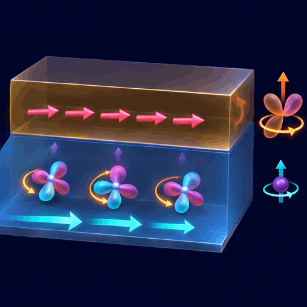
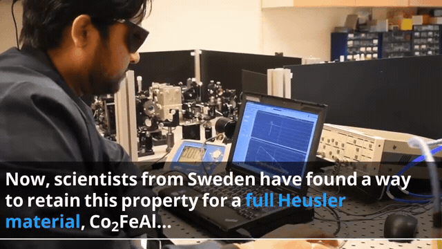

```{=html}
<div style="text-align: center; margin-bottom: 2rem;">
  <p style="font-size: 1.25rem; color: #555; max-width: 820px; margin: 0 auto 1.5rem auto; line-height: 1.6;">
    The GHYAN lab explores the intersection of fundamental quantum physics and next-generation device applications, focusing on spin and orbital angular momentum in thin films, 2D heterostructures, and nanodevices.
  </p>

  <div class="section-jump-nav">
    <a href="#research-areas" class="section-jump-link">
      <svg width="16" height="16" viewBox="0 0 24 24" fill="none" stroke="currentColor" stroke-width="2"><circle cx="12" cy="12" r="10"/><path d="m9 12 2 2 4-4"/></svg>
      Research Areas
    </a>
    <a href="#research-grants" class="section-jump-link">
      <svg width="16" height="16" viewBox="0 0 24 24" fill="none" stroke="currentColor" stroke-width="2"><path d="M12 2v20M17 5H9.5a3.5 3.5 0 0 0 0 7h5a3.5 3.5 0 0 1 0 7H6"/></svg>
      Research Grants &amp; Funding
    </a>
    <a href="#collaborations" class="section-jump-link">
      <svg width="16" height="16" viewBox="0 0 24 24" fill="none" stroke="currentColor" stroke-width="2"><circle cx="18" cy="5" r="3"/><circle cx="6" cy="12" r="3"/><circle cx="18" cy="19" r="3"/><line x1="8.59" y1="13.51" x2="15.42" y2="17.49"/><line x1="15.41" y1="6.51" x2="8.59" y2="10.49"/></svg>
      Collaborations &amp; Visits
    </a>
  </div>
</div>
```

<hr style="margin: 2rem auto 3rem auto; border: 0; border-top: 1px solid #eaeaea; max-width: 900px;">

<!-- ======================================================== -->
<!-- SECTION 1: RESEARCH AREAS                               -->
<!-- ======================================================== -->

<div id="research-areas" class="research-section-header">
  <h2>Research Areas</h2>
  <p>Core experimental thrust areas investigating quantum angular momentum, ultrafast dynamics, and device physics</p>
</div>

:::: {.research-row}
::: {.research-text}
### Magnetism &amp; Spintronics
We study the fundamental magnetic properties of novel quantum materials and how electron spin can be utilized for energy-efficient memory and logic devices. By understanding spin transport, spin-orbit torque (SOT), and spin dynamics, we aim to design next-generation magnetic RAM (SOT-MRAM) and spin-logic architectures that drastically reduce standby and switching power consumption.

```{=html}
<div class="research-pubs">
  <div class="research-pubs-heading">Key Publications</div>
  <ul class="research-pubs-list">
    <li class="research-pub-item">
      <a href="https://doi.org/10.1038/s41467-024-55437-x" target="_blank" rel="noopener noreferrer">
        Harnessing orbital Hall effect in spin-orbit torque MRAM ↗
      </a>
      <div class="research-pub-journal">Nature Communications 16, 130 (2025)</div>
    </li>
    <li class="research-pub-item">
      <a href="https://doi.org/10.1021/acsnano.3c10649" target="_blank" rel="noopener noreferrer">
        Strong In-Plane Magnetization and Spin Polarization in CFGT/Graphene Heterostructure Spin-Valve ↗
      </a>
      <div class="research-pub-journal">ACS Nano 18 (7), 5240–5248 (2024)</div>
    </li>
    <li class="research-pub-item">
      <a href="https://doi.org/10.1063/5.0025318" target="_blank" rel="noopener noreferrer">
        Emergence of spin–orbit torques in 2D transition metal dichalcogenides: A status update ↗
      </a>
      <div class="research-pub-journal">Applied Physics Reviews 7, 041312 (2020)</div>
    </li>
  </ul>
</div>
```
:::
::: {.research-image}

:::
::::

:::: {.research-row}
::: {.research-text}
### Orbitronics
Beyond the spin degree of freedom, orbital angular momentum offers an exciting, energy-efficient dimension for information processing. We investigate orbital angular momentum-driven transport phenomena, including the orbital Hall effect (OHE) and orbital Rashba-Edelstein effect, in light metals (such as Ru, Cr, etc.) and transition metal oxides, unlocking pathways for high-efficiency torque generation without relying on heavy or scarce elements.

```{=html}
<div class="research-pubs">
  <div class="research-pubs-heading">Key Publications</div>
  <ul class="research-pubs-list">
    <li class="research-pub-item">
      <a href="https://doi.org/10.1021/acs.nanolett.5c02641" target="_blank" rel="noopener noreferrer">
        Identification of orbital pumping from spin pumping and rectification effects ↗
      </a>
      <div class="research-pub-journal">Nano Letters 25 (36), 13462–13467 (2025)</div>
    </li>
    <li class="research-pub-item">
      <a href="https://arxiv.org/abs/2508.16339" target="_blank" rel="noopener noreferrer">
        Itinerant orbital Hall effect mechanism leading to large negative orbital torques from light metal vanadium ↗
      </a>
      <div class="research-pub-journal">arXiv:2508.16339 (2025)</div>
    </li>
    <li class="research-pub-item">
      <a href="https://doi.org/10.1021/acs.nanolett.4c06056" target="_blank" rel="noopener noreferrer">
        Nonreciprocity in magnon mediated charge-spin-orbital current interconversion ↗
      </a>
      <div class="research-pub-journal">Nano Letters 25 (8), 3247–3252 (2025)</div>
    </li>
  </ul>
</div>
```
:::
::: {.research-image}

:::
::::

:::: {.research-row}
::: {.research-text}
### Terahertz Spin-Orbitronics
Exploring the generation, manipulation, and detection of terahertz (THz) radiation using ultrafast spin-orbitronic heterostructures. By exploiting inverse spin and orbital Hall effects, anomalous Hall phenomena, we develop ultra-broadband, low-cost spintronic THz emitters (STEs) for high-speed wireless communication, radar, and non-destructive spectroscopic imaging.

```{=html}
<div class="research-pubs">
  <div class="research-pubs-heading">Key Publications</div>
  <ul class="research-pubs-list">
        <li class="research-pub-item">
      <a href="https://arxiv.org/abs/2401.10123" target="_blank" rel="noopener noreferrer">
        Terahertz emission from β-W/CoFe epitaxial spintronic emitters ↗
      </a>
      <div class="research-pub-journal">arXiv:2401.10123 (2024) (accepted in Scientific Reports)</div>
    </li>
    <li class="research-pub-item">
      <a href="https://doi.org/10.1038/s41598-023-33143-w" target="_blank" rel="noopener noreferrer">
        Direct evidence of terahertz emission arising from anomalous Hall effect ↗
      </a>
      <div class="research-pub-journal">Scientific Reports 13, 5988 (2023)</div>
    </li>
        <li class="research-pub-item">
      <a href="https://doi.org/10.1002/adom.202001987" target="_blank" rel="noopener noreferrer">
        Co2FeAl Full Heusler Compound Based Spintronic Terahertz Emitter ↗
      </a>
      <div class="research-pub-journal">Advanced Optical Materials 9 (10), 2001987 (2021)</div>
    </li>
  </ul>
</div>
```
:::
::: {.research-image}

:::
::::

:::: {.research-row}
::: {.research-text}
### Quantum Sensing: Spin-Orbit Torque (SOT) and Nitrogen-Vacancy (NV) Centers
We aim to utilize nitrogen-vacancy (NV) diamond center magnetometry and atomic-scale quantum sensors to non-invasively probe nanoscale spin configurations, stray magnetic fields, and spin currents with high spatial resolution and sensitivity. By integrating NV center quantum defects with magnetic heterostructures, 2D quantum materials, and spintronic devices, we investigate local spin-orbit torque switching, magnon dynamics, and topological spin textures (such as domain walls and skyrmions) from cryogenic to room temperatures.

```{=html}
<div class="research-pubs">
  <div class="research-pubs-heading">Key Publications in Quantum-Enabled Spintronic Sensing</div>
  <ul class="research-pubs-list">
    <li class="research-pub-item">
      <a href="https://doi.org/10.1002/adfm.202600059" target="_blank" rel="noopener noreferrer">
        Three‐Dimensional Anomalous Hall Sensing Enabled By Spin–Orbit Torque Driven Domain Reconfiguration ↗
      </a>
      <div class="research-pub-journal">Advanced Functional Materials 36 (70), 2600059 (2026)</div>
    </li>
    <li class="research-pub-item">
      <a href="https://doi.org/10.1103/PhysRevApplied.20.044079" target="_blank" rel="noopener noreferrer">
        Single-device offset-free magnetic field sensing with tunable sensitivity and linear range ↗
      </a>
      <div class="research-pub-journal">Physical Review Applied 20, 044079 (2023)</div>
    </li>
  </ul>
</div>
```
:::
::: {.research-image}

:::
::::

<hr style="margin: 4.5rem auto 3rem auto; border: 0; border-top: 1px solid #eaeaea; max-width: 900px;">

<!-- ======================================================== -->
<!-- SECTION 2: RESEARCH GRANTS AND FUNDING                   -->
<!-- ======================================================== -->

<div id="research-grants" class="research-section-header">
  <h2>Research Grants and Funding</h2>
  <p>External and institutional sponsored research projects supporting our experimental investigations and laboratory infrastructure</p>
</div>

```{=html}
<div class="grant-grid">
  <!-- GRANT 2: IIT ISM Initiation Grant -->
  <div class="grant-card">
    <div class="grant-header">
      <div>
        <h3 class="grant-title">GHYAN Laboratory Establishment &amp; Faculty Research Grant</h3>
        <p style="margin: 0.35rem 0 0 0; color: #27ae60; font-weight: 600; font-size: 0.95rem;">
          Indian Institute of Technology (Indian School of Mines), Dhanbad
        </p>
      </div>
      <span class="grant-status-badge">Active</span>
    </div>
    <div class="grant-meta">
      <div class="grant-meta-item"><strong>Principal Investigator:</strong> Dr. Rahul Gupta</div>
      <div class="grant-meta-item"><strong>Funding Body:</strong> IIT (ISM) Dhanbad</div>
      <div class="grant-meta-item"><strong>Department:</strong> Department of Physics</div>
      <div class="grant-meta-item"><strong>Timeline:</strong> 2026 – Present</div>
    </div>
    <p class="grant-desc">
    </p>
  </div>

<!-- GRANT 2: Royal Swedish Academy of Sciences Scholarship -->
  <div class="grant-card" style="margin-top: 1.5rem;">
    <div class="grant-header">
      <div>
        <h3 class="grant-title">General Physics Scholarship, Project QRBIT-Q</h3>
        <p style="margin: 0.35rem 0 0 0; color: #0284c7; font-weight: 600; font-size: 0.95rem;">
          The Royal Swedish Academy of Sciences (Kungliga Vetenskapsakademien), Sweden
        </p>
      </div>
      <span class="grant-status-badge">Scholarship</span>
    </div>
    <div class="grant-meta">
      <div class="grant-meta-item"><strong>Recipient:</strong> Dr. Rahul Gupta</div>
      <div class="grant-meta-item"><strong>Funding Body:</strong> The Royal Swedish Academy of Sciences, Sweden</div>
      <div class="grant-meta-item"><strong>Period:</strong> 2025-Present</div>
      <div class="grant-meta-item"><strong>Domain:</strong> Quantum Sensing (Nitrogen-Vacancy Centers)</div>
    </div>
    <p class="grant-desc">
    </p>
  </div>

  <!-- GRANT 3: Swedish Research Council (VR) -->
  <div class="grant-card">
    <div class="grant-header">
      <div>
        <h3 class="grant-title">T-SHNO: Terahertz Spin Hall Nano Oscillator</h3>
        <p style="margin: 0.35rem 0 0 0; color: #003e6b; font-weight: 600; font-size: 0.95rem;">
          Swedish Research Council (Vetenskapsrådet - VR) &bull; Project ID: 2023-06605
        </p>
      </div>
      <span class="grant-status-badge">Funded Project</span>
    </div>
    <div class="grant-meta">
      <div class="grant-meta-item"><strong>Principal Investigator:</strong> Dr. Rahul Gupta</div>
      <div class="grant-meta-item"><strong>Funding Agency:</strong> Swedish Research Council (Vetenskapsrådet), Sweden</div>
      <div class="grant-meta-item"><strong>Domain:</strong> Terahertz Spintronics &amp; Nano-Devices</div>
      <div class="grant-meta-item"><strong>Timeline:</strong> 2024 – 2026</div>
    </div>
    <p class="grant-desc">
    </p>
    <div>
      <a href="https://www.vr.se/english/swecris.html#/project/2023-06605_VR" target="_blank" rel="noopener noreferrer" class="grant-link">
        View Project Details on Swecris (Swedish Research Council Portal) ↗
      </a>
    </div>
  </div>

  <!-- GRANT 4: Erasmus+ Staff Exchange Fellowship -->
  <div class="grant-card">
    <div class="grant-header">
      <div>
        <h3 class="grant-title">Erasmus+ Staff Exchange Fellowship</h3>
        <p style="margin: 0.35rem 0 0 0; color: #475569; font-weight: 600; font-size: 0.95rem;">
          International Office, Uppsala University, Sweden
        </p>
      </div>
      <span class="grant-status-badge" style="background: rgba(100, 116, 139, 0.12); color: #475569;">Fellowship</span>
    </div>
    <div class="grant-meta">
      <div class="grant-meta-item"><strong>Recipient:</strong> Dr. Rahul Gupta</div>
      <div class="grant-meta-item"><strong>Funding Body:</strong> International Office, Uppsala University, Sweden</div>
      <div class="grant-meta-item"><strong>Timeline:</strong> May 2022</div>
    </div>
    <p class="grant-desc">
    </p>
  </div>

</div>
```

<hr style="margin: 4.5rem auto 3rem auto; border: 0; border-top: 1px solid #eaeaea; max-width: 900px;">

<!-- ======================================================== -->
<!-- SECTION 3: COLLABORATIONS                                -->
<!-- ======================================================== -->

<div id="collaborations" class="research-section-header">
  <h2>Collaborations &amp; Academic Visits</h2>
  <p>Our group actively collaborates with leading international and national research institutions, university departments, and research facilities worldwide</p>
</div>

```{=html}
<!-- Leaflet CSS and JS CDN -->
<link rel="stylesheet" href="https://unpkg.com/leaflet@1.9.4/dist/leaflet.css" integrity="sha256-p4NxAoJBhIIN+hmNHrzRCf9tD/miZyoHS5obTRR9BMY=" crossorigin="" />
<script src="https://unpkg.com/leaflet@1.9.4/dist/leaflet.js" integrity="sha256-20nQCchB9co0qIjJZRGuk2/Z9VM+kNiyxNV1lvTlZBo=" crossorigin=""></script>

<style>
/* Self-contained styling for Collaboration Map (immune to browser CSS caching) */
.collab-map-container {
  max-width: 1020px;
  margin: 0 auto 3rem auto;
  background: #ffffff;
  border: 1px solid #e2e8f0;
  border-radius: 16px;
  padding: 1.5rem;
  box-shadow: 0 4px 25px rgba(0, 0, 0, 0.04);
}
.collab-map-header {
  display: flex;
  justify-content: space-between;
  align-items: center;
  flex-wrap: wrap;
  gap: 1rem;
  margin-bottom: 1.25rem;
}
.collab-map-badge {
  display: inline-flex;
  align-items: center;
  gap: 0.45rem;
  font-size: 0.75rem;
  font-weight: 700;
  text-transform: uppercase;
  letter-spacing: 0.06em;
  color: #1e824c;
  background: rgba(39, 174, 96, 0.1);
  padding: 0.3rem 0.75rem;
  border-radius: 20px;
  margin-bottom: 0.4rem;
}
.collab-pulse-dot {
  width: 8px;
  height: 8px;
  border-radius: 50%;
  background: #27ae60;
  box-shadow: 0 0 0 0 rgba(39, 174, 96, 0.7);
  animation: pulseDot 1.8s infinite;
}
@keyframes pulseDot {
  0% { transform: scale(0.95); box-shadow: 0 0 0 0 rgba(39, 174, 96, 0.7); }
  70% { transform: scale(1); box-shadow: 0 0 0 8px rgba(39, 174, 96, 0); }
  100% { transform: scale(0.95); box-shadow: 0 0 0 0 rgba(39, 174, 96, 0); }
}
.collab-map-title {
  font-size: 1.35rem;
  font-weight: 800;
  color: #1e293b;
  margin: 0.2rem 0;
}
.collab-map-subtitle {
  font-size: 0.88rem;
  color: #64748b;
  margin: 0;
  max-width: 620px;
}
.collab-map-actions {
  display: flex;
  flex-wrap: wrap;
  align-items: center;
  gap: 0.4rem;
}
.collab-region-btn,
.collab-toggle-btn {
  background: #f8fafc !important;
  border: 1px solid #cbd5e1 !important;
  color: #334155 !important;
  font-size: 0.82rem !important;
  font-weight: 600 !important;
  padding: 0.4rem 0.75rem !important;
  border-radius: 8px !important;
  cursor: pointer !important;
  transition: all 0.2s ease !important;
  display: inline-flex !important;
  align-items: center !important;
  gap: 0.35rem !important;
}
.collab-region-btn:hover,
.collab-toggle-btn:hover {
  background: #e2e8f0 !important;
  color: #0f172a !important;
  border-color: #94a3b8 !important;
}
.collab-region-btn.active,
.collab-toggle-btn.active {
  background: #0284c7 !important;
  color: #ffffff !important;
  border-color: #0284c7 !important;
  box-shadow: 0 2px 8px rgba(2, 132, 199, 0.3) !important;
}
#collab-map {
  width: 100% !important;
  height: 560px !important;
  min-height: 560px !important;
  border-radius: 12px !important;
  border: 1px solid #cbd5e1 !important;
  background: #edf2f7 !important;
  z-index: 1 !important;
  overflow: hidden !important;
  position: relative !important;
  display: block !important;
}
.collab-map-status-bar {
  display: flex;
  justify-content: space-between;
  align-items: center;
  flex-wrap: wrap;
  gap: 0.75rem;
  margin-top: 0.85rem;
  padding: 0.6rem 0.9rem;
  background: #f8fafc;
  border: 1px solid #e2e8f0;
  border-radius: 8px;
  font-size: 0.82rem;
  color: #475569;
}
.collab-map-status-text {
  display: flex;
  align-items: center;
  gap: 0.4rem;
  color: #0284c7;
  font-weight: 600;
}
.collab-map-legend {
  display: flex;
  flex-wrap: wrap;
  justify-content: center;
  align-items: center;
  gap: 1.5rem;
  font-size: 0.85rem;
  color: #475569;
}
.legend-item {
  display: inline-flex;
  align-items: center;
  gap: 0.5rem;
}
.legend-dot {
  width: 12px;
  height: 12px;
  border-radius: 50%;
  display: inline-block;
}
.legend-dot.home-dot {
  background: #16a34a;
  border: 2px solid #ffffff;
  box-shadow: 0 0 0 2px #16a34a;
}
.legend-dot.partner-dot {
  background: #0284c7;
  border: 2px solid #ffffff;
  box-shadow: 0 0 0 2px #0284c7;
}
.legend-dot.visit-dot {
  background: #e67e22;
  border: 2px solid #ffffff;
  box-shadow: 0 0 0 2px #e67e22;
}

/* Academic Visits Styling */
.visits-section {
  max-width: 1020px;
  margin: 3.5rem auto 3rem auto;
}
.visits-grid {
  display: grid;
  grid-template-columns: repeat(2, 1fr);
  gap: 0.85rem;
  margin-top: 1.5rem;
}
@media (max-width: 768px) {
  .visits-grid {
    grid-template-columns: 1fr;
    gap: 0.75rem;
  }
}
.visit-item {
  background: #ffffff;
  border: 1px solid #e2e8f0;
  border-radius: 10px;
  padding: 0.85rem 1.1rem;
  display: flex;
  align-items: center;
  gap: 0.85rem;
  transition: all 0.2s ease;
  cursor: pointer;
  box-shadow: 0 2px 8px rgba(0, 0, 0, 0.02);
  text-decoration: none !important;
  color: inherit !important;
}
.visit-item:hover,
.visit-item.active-visit {
  background: #fffbf5;
  border-color: #e67e22;
  transform: translateY(-2px);
  box-shadow: 0 4px 15px rgba(230, 126, 34, 0.12);
}
.visit-item-left {
  display: flex;
  align-items: center;
  gap: 0.5rem;
  flex-shrink: 0;
}
.visit-dot-badge {
  width: 9px;
  height: 9px;
  border-radius: 50%;
  background: #e67e22;
  box-shadow: 0 0 0 2px rgba(230, 126, 34, 0.2);
  flex-shrink: 0;
}
.visit-year-pill {
  font-size: 0.74rem;
  font-weight: 700;
  padding: 0.2rem 0.55rem;
  border-radius: 12px;
  background: #fef3c7;
  color: #92400e;
  letter-spacing: 0.02em;
}
.visit-item-content {
  flex: 1;
  min-width: 0;
}
.visit-title {
  font-size: 0.92rem;
  font-weight: 600;
  color: #1e293b;
  line-height: 1.35;
}
.visit-meta {
  font-size: 0.8rem;
  color: #64748b;
  margin-top: 0.15rem;
  line-height: 1.3;
}
.visit-locate-hint {
  font-size: 0.85rem;
  opacity: 0.4;
  transition: opacity 0.2s ease, transform 0.2s ease;
  flex-shrink: 0;
}
.visit-item:hover .visit-locate-hint,
.visit-item.active-visit .visit-locate-hint {
  opacity: 1;
  transform: scale(1.2);
}
.visit-marker-wrap {
  position: relative;
  cursor: pointer;
  display: flex;
  align-items: center;
  justify-content: center;
  width: 14px;
  height: 14px;
}
.visit-marker-dot {
  width: 10px;
  height: 10px;
  border-radius: 50%;
  background: #e67e22;
  border: 2px solid #ffffff;
  box-shadow: 0 0 0 1px #e67e22, 0 2px 6px rgba(230, 126, 34, 0.35);
  transition: transform 0.2s cubic-bezier(0.34, 1.56, 0.64, 1), background 0.2s, box-shadow 0.2s;
  flex-shrink: 0;
}
.visit-marker-wrap:hover .visit-marker-dot,
.visit-marker-wrap.active .visit-marker-dot {
  transform: scale(1.5);
  background: #d35400;
  box-shadow: 0 0 0 2px #ffffff, 0 0 12px rgba(230, 126, 34, 0.7);
}
.map-zoomed-in .visit-marker-wrap .collab-marker-label,
.visit-marker-wrap:hover .collab-marker-label,
.show-all-labels .visit-marker-wrap .collab-marker-label {
  opacity: 1 !important;
  visibility: visible !important;
  pointer-events: auto !important;
}
.visit-label-inst {
  font-size: 0.7rem;
  font-weight: 600;
  color: #d35400;
  display: block;
  line-height: 1.25;
  margin-top: 1px;
}
.visit-popup-tag {
  font-size: 0.72rem;
  font-weight: 700;
  text-transform: uppercase;
  letter-spacing: 0.05em;
  color: #d35400;
  margin-bottom: 0.2rem;
}
.collab-marker-wrap {
  position: relative;
  cursor: pointer;
  display: flex;
  align-items: center;
  justify-content: center;
  width: 14px;
  height: 14px;
}
.collab-marker-dot {
  width: 11px;
  height: 11px;
  border-radius: 50%;
  background: #0284c7;
  border: 2px solid #ffffff;
  box-shadow: 0 0 0 1px #0284c7, 0 2px 6px rgba(0, 0, 0, 0.25);
  transition: transform 0.2s cubic-bezier(0.34, 1.56, 0.64, 1), background 0.2s, box-shadow 0.2s;
  flex-shrink: 0;
}
.collab-marker-wrap:hover .collab-marker-dot,
.collab-marker-wrap.active .collab-marker-dot {
  transform: scale(1.5);
  background: #16a34a;
  box-shadow: 0 0 0 2px #ffffff, 0 0 12px rgba(22, 163, 74, 0.7);
}
.collab-marker-label {
  position: absolute;
  left: 18px;
  top: 50%;
  transform: translateY(-50%) translateX(4px);
  background: #ffffff;
  border: 1px solid #cbd5e1;
  border-radius: 8px;
  padding: 5px 10px;
  box-shadow: 0 4px 15px rgba(0, 0, 0, 0.14);
  white-space: nowrap;
  pointer-events: none;
  opacity: 0;
  visibility: hidden;
  transition: opacity 0.25s ease, transform 0.25s ease, visibility 0.25s ease;
  z-index: 800;
}
.collab-marker-label::before {
  content: '';
  position: absolute;
  right: 100%;
  top: 50%;
  transform: translateY(-50%);
  border-right: 6px solid #ffffff;
  border-top: 5px solid transparent;
  border-bottom: 5px solid transparent;
}
.collab-marker-label.pos-top {
  left: 50%;
  top: auto;
  bottom: 18px;
  transform: translateX(-50%) translateY(-4px);
}
.collab-marker-label.pos-top::before {
  right: auto;
  left: 50%;
  top: 100%;
  transform: translateX(-50%);
  border-right: 5px solid transparent;
  border-left: 5px solid transparent;
  border-top: 6px solid #ffffff;
  border-bottom: none;
}
.collab-marker-label.pos-bottom {
  left: 50%;
  top: 18px;
  bottom: auto;
  transform: translateX(-50%) translateY(4px);
}
.collab-marker-label.pos-bottom::before {
  right: auto;
  left: 50%;
  top: auto;
  bottom: 100%;
  transform: translateX(-50%);
  border-right: 5px solid transparent;
  border-left: 5px solid transparent;
  border-bottom: 6px solid #ffffff;
  border-top: none;
}
.collab-label-name {
  font-size: 0.78rem;
  font-weight: 700;
  color: #0f172a;
  display: block;
  line-height: 1.3;
}
.collab-label-inst {
  font-size: 0.7rem;
  font-weight: 600;
  color: #16a34a;
  display: block;
  line-height: 1.25;
  margin-top: 1px;
}
.map-zoomed-in .collab-marker-label,
.collab-marker-wrap:hover .collab-marker-label,
.show-all-labels .collab-marker-label {
  opacity: 1 !important;
  visibility: visible !important;
  pointer-events: auto !important;
  transform: translateY(-50%) translateX(0) !important;
}
.map-zoomed-in .collab-marker-label.pos-top,
.collab-marker-wrap:hover .collab-marker-label.pos-top,
.show-all-labels .collab-marker-label.pos-top {
  transform: translateX(-50%) translateY(0) !important;
}
.map-zoomed-in .collab-marker-label.pos-bottom,
.collab-marker-wrap:hover .collab-marker-label.pos-bottom,
.show-all-labels .collab-marker-label.pos-bottom {
  transform: translateX(-50%) translateY(0) !important;
}
.home-marker-wrap {
  position: relative;
  display: flex;
  align-items: center;
  justify-content: center;
  cursor: pointer;
}
.home-marker-core {
  width: 22px;
  height: 22px;
  border-radius: 50%;
  background: #16a34a;
  border: 2.5px solid #ffffff;
  color: #ffffff;
  font-size: 11px;
  font-weight: 800;
  display: flex;
  align-items: center;
  justify-content: center;
  box-shadow: 0 0 0 2px #16a34a, 0 3px 8px rgba(0,0,0,0.3);
  z-index: 2;
  transition: transform 0.2s ease;
}
.home-marker-wrap:hover .home-marker-core {
  transform: scale(1.25);
}
.home-marker-pulse {
  position: absolute;
  width: 38px;
  height: 38px;
  border-radius: 50%;
  background: rgba(22, 163, 74, 0.4);
  animation: homePulse 2s cubic-bezier(0.24, 0, 0.38, 1) infinite;
  z-index: 1;
  pointer-events: none;
}
@keyframes homePulse {
  0% { transform: scale(0.5); opacity: 1; }
  100% { transform: scale(1.6); opacity: 0; }
}
.home-marker-label {
  position: absolute;
  left: 26px;
  top: 50%;
  transform: translateY(-50%);
  background: #16a34a;
  color: #ffffff;
  border: 1px solid #15803d;
  border-radius: 6px;
  padding: 4px 9px;
  box-shadow: 0 4px 14px rgba(22, 163, 74, 0.35);
  white-space: nowrap;
  font-size: 0.74rem;
  font-weight: 700;
  z-index: 850;
  pointer-events: none;
}
.collab-svg-layer {
  position: absolute;
  left: 0;
  top: 0;
  width: 100%;
  height: 100%;
  pointer-events: none;
  overflow: visible;
  z-index: 450;
}
.collab-arc-path {
  fill: none;
  stroke: #16a34a;
  stroke-width: 2.2px;
  stroke-dasharray: 6, 5;
  stroke-opacity: 0.8;
  pointer-events: stroke;
  cursor: pointer;
  transition: stroke 0.2s ease, stroke-width 0.2s ease, stroke-opacity 0.2s ease;
}
.collab-arc-path:hover,
.collab-arc-path.active {
  stroke: #0284c7;
  stroke-width: 3.5px;
  stroke-opacity: 1;
  stroke-dasharray: none;
}
@media (max-width: 768px) {
  #collab-map {
    height: 420px !important;
    min-height: 420px !important;
  }
  .collab-map-header {
    flex-direction: column;
    align-items: flex-start;
  }
}
</style>

<!-- Global Collaboration Map Component -->
<div class="collab-map-container" id="collab-map-container">
  <div class="collab-map-header">
    <div>
      <div class="collab-map-badge">
        <span class="collab-pulse-dot"></span> Active Research &amp; Visit Network
      </div>
      <h3 class="collab-map-title">Global Collaboration &amp; Academic Network</h3>
      <p class="collab-map-subtitle">
        Our research group maintains a vibrant network of international collaborators, research visits, conferences, and advanced facilities across Europe, the Americas, and Asia.
      </p>
    </div>
    
    <!-- Region Preset Buttons and Label Toggle -->
    <div class="collab-map-actions">
      <button class="collab-region-btn active" id="btn-view-world" type="button" title="View Full World Map">🌍 World View</button>
      <button class="collab-region-btn" id="btn-view-europe" type="button" title="Zoom into European Collaborators &amp; Visits">🇪🇺 Europe</button>
      <button class="collab-region-btn" id="btn-view-india" type="button" title="Zoom into Indian Institutions &amp; Visits">🇮🇳 India</button>
      <button class="collab-region-btn" id="btn-view-usa" type="button" title="Zoom into US Collaborators &amp; Visits">🇺🇸 USA</button>
      <button class="collab-toggle-btn" id="btn-toggle-labels" type="button" title="Toggle Names On/Off">🏷️ Show Names</button>
    </div>
  </div>

  <!-- The Map Canvas with guaranteed inline fallback dimensions -->
  <div id="collab-map" style="width: 100%; height: 560px; min-height: 560px; border-radius: 12px; background: #edf2f7; position: relative; overflow: hidden; display: block;"></div>

  <!-- Status & Legend Bar -->
  <div class="collab-map-status-bar">
    <div class="collab-map-status-text" id="map-zoom-status">
      🌍 World View &bull; Zoom in or click a region to see more details
    </div>
    <div class="collab-map-legend">
      <div class="legend-item">
        <span class="legend-dot home-dot"></span>
        <span><strong>Primary Hub:</strong> GHYAN Lab, IIT (ISM) Dhanbad</span>
      </div>
      <div class="legend-item">
        <span class="legend-dot partner-dot"></span>
        <span><strong>Collaborators:</strong> Global Partners</span>
      </div>
      <div class="legend-item">
        <span class="legend-dot visit-dot"></span>
        <span><strong>Academic Visits:</strong> Workshops, Conferences &amp; Labs</span>
      </div>
    </div>
  </div>
</div>

<!-- ======================================================================= -->
<!-- COLLABORATORS LIST                                                      -->
<!-- Note: The map above automatically discovers every .collab-card below.   -->
<!-- When you add a new card with data-country="..." (and optional data-lat  -->
<!-- & data-lng), the dot and arrow from Dhanbad are added automatically!    -->
<!-- ======================================================================= -->
<div class="collab-grid">

  <!-- COLLAB 1: Johannes Gutenberg University Mainz -->
  <div class="collab-card" id="collab-jgu-mainz" data-country="Germany" data-city="Mainz" data-institution="Johannes Gutenberg University Mainz" data-lat="49.9929" data-lng="8.2473" data-label-pos="right">
    <div class="collab-country-tag">Germany</div>
    <h3 class="collab-institution">Johannes Gutenberg University Mainz</h3>
    <div class="collab-group">Prof. Mathias Kläui &amp; Dr. Gerhard Jakob</div>
  </div>

  <!-- COLLAB 2: Uppsala University -->
  <div class="collab-card" id="collab-uu" data-country="Sweden" data-city="Uppsala" data-institution="Uppsala University" data-lat="59.8586" data-lng="17.6389" data-label-pos="top">
    <div class="collab-country-tag">Sweden</div>
    <h3 class="collab-institution">Uppsala University</h3>
    <div class="collab-group">Prof. Peter Svedlindh, Prof. Peter M. Oppeneer, Prof. Olle Eriksson, Prof. Olof Karis, Prof. Biplab Sanyal, Dr. M. Venkata Kamalakar, Dr. Ronny Knut &amp; Dr. Rimantas Brucas</div>
  </div>

  <!-- COLLAB 3: University of Gothenburg -->
  <div class="collab-card" id="collab-gu" data-country="Sweden" data-city="Gothenburg" data-institution="University of Gothenburg" data-lat="57.7089" data-lng="11.9746" data-label-pos="bottom">
    <div class="collab-country-tag">Sweden</div>
    <h3 class="collab-institution">University of Gothenburg</h3>
    <div class="collab-group">Prof. Johan Åkerman</div>
  </div>

  <!-- COLLAB 4: Aix-Marseille University -->
  <div class="collab-card" id="collab-amu" data-country="France" data-city="Marseille" data-institution="Aix-Marseille University" data-lat="43.2965" data-lng="5.3698" data-label-pos="bottom">
    <div class="collab-country-tag">France</div>
    <h3 class="collab-institution">Aix-Marseille University</h3>
    <div class="collab-group">Prof. Aurélien Manchon</div>
  </div>

  <!-- COLLAB 5: University of Vienna -->
  <div class="collab-card" id="collab-univie" data-country="Austria" data-city="Vienna" data-institution="University of Vienna" data-lat="48.2082" data-lng="16.3738" data-label-pos="right">
    <div class="collab-country-tag">Austria</div>
    <h3 class="collab-institution">University of Vienna</h3>
    <div class="collab-group">Prof. Dieter Suess</div>
  </div>

  <!-- COLLAB 6: University of Central Florida -->
  <div class="collab-card" id="collab-ucf" data-country="United States" data-city="Orlando" data-institution="University of Central Florida" data-lat="28.6024" data-lng="-81.2001" data-label-pos="top">
    <div class="collab-country-tag">United States</div>
    <h3 class="collab-institution">University of Central Florida</h3>
    <div class="collab-group">Prof. Enrique del Barco</div>
  </div>

  <!-- COLLAB 7: University of South Florida -->
  <div class="collab-card" id="collab-usf" data-country="United States" data-city="Tampa" data-institution="University of South Florida" data-lat="28.0587" data-lng="-82.4139" data-label-pos="bottom">
    <div class="collab-country-tag">United States</div>
    <h3 class="collab-institution">University of South Florida</h3>
    <div class="collab-group">Prof. Dario A. Arena</div>
  </div>

  <!-- COLLAB 8: Indian Institute of Technology Delhi -->
  <div class="collab-card" id="collab-iitd" data-country="India" data-city="New Delhi" data-institution="Indian Institute of Technology Delhi" data-lat="28.5450" data-lng="77.1926" data-label-pos="top">
    <div class="collab-country-tag">India</div>
    <h3 class="collab-institution">Indian Institute of Technology Delhi</h3>
    <div class="collab-group">Prof. Sujeet Chaudhary &amp; Prof. Pranaba Kishor Muduli</div>
  </div>

  <!-- COLLAB 9: Örebro University -->
  <div class="collab-card" id="collab-oru" data-country="Sweden" data-city="Örebro" data-institution="Örebro University" data-lat="59.2753" data-lng="15.2134" data-label-pos="right">
    <div class="collab-country-tag">Sweden</div>
    <h3 class="collab-institution">Örebro University</h3>
    <div class="collab-group">Dr. Danny Thonig</div>
  </div>

  <!-- COLLAB 10: Chalmers University of Technology -->
  <div class="collab-card" id="collab-chalmers" data-country="Sweden" data-city="Gothenburg" data-institution="Chalmers University of Technology" data-lat="57.6888" data-lng="11.9782" data-label-pos="top">
    <div class="collab-country-tag">Sweden</div>
    <h3 class="collab-institution">Chalmers University of Technology</h3>
    <div class="collab-group">Prof. Saroj P. Dash</div>
  </div>

  <!-- COLLAB 11: S. N. Bose National Centre for Basic Sciences -->
  <div class="collab-card" id="collab-snbose" data-country="India" data-city="Kolkata" data-institution="S. N. Bose National Centre for Basic Sciences" data-lat="22.5697" data-lng="88.4069" data-label-pos="right">
    <div class="collab-country-tag">India</div>
    <h3 class="collab-institution">S. N. Bose National Centre for Basic Sciences</h3>
    <div class="collab-group">Prof. Anjan Barman</div>
  </div>

  <!-- COLLAB 12: Empa – Swiss Federal Laboratories -->
  <div class="collab-card" id="collab-empa" data-country="Switzerland" data-city="Dübendorf" data-institution="Empa – Swiss Federal Laboratories" data-lat="47.3769" data-lng="8.5417" data-label-pos="bottom">
    <div class="collab-country-tag">Switzerland</div>
    <h3 class="collab-institution">Empa – Swiss Federal Laboratories</h3>
    <div class="collab-group">Dr. Hans Josef Hug &amp; Dr. Andrada Oana Mandru</div>
  </div>

  <!-- COLLAB 13: Central Research Facility (CRF), IIT (ISM) -->
  <div class="collab-card" id="collab-crf" data-country="India" data-city="Dhanbad" data-institution="Central Research Facility (CRF), IIT (ISM)" data-lat="23.8144" data-lng="86.4412">
    <div class="collab-country-tag">India &bull; Internal</div>
    <h3 class="collab-institution">Central Research Facility (CRF), IIT (ISM)</h3>
    <div class="collab-group">IIT (ISM) Dhanbad Facilities</div>
  </div>

</div>

<!-- ======================================================================= -->
<!-- ACADEMIC VISITS & SCIENTIFIC EXCHANGES                                   -->
<!-- ======================================================================= -->
<div class="visits-section" id="academic-visits">
  <div style="text-align: center; margin-bottom: 1.75rem; margin-top: 3.5rem;">
    <h3 style="font-size: 1.6rem; font-weight: 800; color: #1e293b; margin-bottom: 0.4rem;">
      Academic Visits &amp; Scientific Exchanges
    </h3>
    <p style="color: #64748b; font-size: 0.95rem; max-width: 720px; margin: 0 auto;">
      International research visits, conferences, advanced schools, and workshops. Click any visit to locate it on the map above.
    </p>
  </div>

  <div class="visits-grid">

    <!-- 1 -->
    <div class="visit-item" id="visit-1" data-lat="42.3601" data-lng="-71.0942" data-title="The Rose Group" data-institution="Massachusetts Institute of Technology" data-city="Massachusetts" data-country="USA" data-year="2025">
      <div class="visit-item-left">
        <span class="visit-dot-badge"></span>
        <span class="visit-year-pill">2025</span>
      </div>
      <div class="visit-item-content">
        <div class="visit-title">The Rose Group, Massachusetts Institute of Technology</div>
        <div class="visit-meta">Massachusetts, USA</div>
      </div>
      <span class="visit-locate-hint" title="Locate on Map">📍</span>
    </div>

    <!-- 2 -->
    <div class="visit-item" id="visit-2" data-lat="40.7295" data-lng="-73.9965" data-title="Kent Laboratory" data-institution="New York University" data-city="New York" data-country="USA" data-year="2025">
      <div class="visit-item-left">
        <span class="visit-dot-badge"></span>
        <span class="visit-year-pill">2025</span>
      </div>
      <div class="visit-item-content">
        <div class="visit-title">Kent Laboratory, New York University</div>
        <div class="visit-meta">New York, USA</div>
      </div>
      <span class="visit-locate-hint" title="Locate on Map">📍</span>
    </div>

    <!-- 3 -->
    <div class="visit-item" id="visit-3" data-lat="26.7153" data-lng="-80.0534" data-title="MMM Conference" data-institution="Conference on Magnetism &amp; Magnetic Materials" data-city="West Palm Beach, Florida" data-country="USA" data-year="2025">
      <div class="visit-item-left">
        <span class="visit-dot-badge"></span>
        <span class="visit-year-pill">2025</span>
      </div>
      <div class="visit-item-content">
        <div class="visit-title">MMM Conference</div>
        <div class="visit-meta">West Palm Beach, Florida, USA</div>
      </div>
      <span class="visit-locate-hint" title="Locate on Map">📍</span>
    </div>

    <!-- 4 -->
    <div class="visit-item" id="visit-4" data-lat="59.6173" data-lng="17.7237" data-title="Orbitronics Workshop" data-institution="International Orbitronics Workshop" data-city="Sigtuna / Stockholm" data-country="Sweden" data-year="2025">
      <div class="visit-item-left">
        <span class="visit-dot-badge"></span>
        <span class="visit-year-pill">2025</span>
      </div>
      <div class="visit-item-content">
        <div class="visit-title">Orbitronics Workshop</div>
        <div class="visit-meta">Sweden</div>
      </div>
      <span class="visit-locate-hint" title="Locate on Map">📍</span>
    </div>

    <!-- 5 -->
    <div class="visit-item" id="visit-5" data-lat="59.8540" data-lng="17.6320" data-title="Trends in Magnetism Workshop" data-institution="Uppsala University" data-city="Uppsala" data-country="Sweden" data-year="2025">
      <div class="visit-item-left">
        <span class="visit-dot-badge"></span>
        <span class="visit-year-pill">2025</span>
      </div>
      <div class="visit-item-content">
        <div class="visit-title">Trends in Magnetism Workshop</div>
        <div class="visit-meta">Uppsala, Sweden</div>
      </div>
      <span class="visit-locate-hint" title="Locate on Map">📍</span>
    </div>

    <!-- 6 -->
    <div class="visit-item" id="visit-6" data-lat="36.6217" data-lng="29.1164" data-title="ICSM Conference" data-institution="International Conference on Superconductivity &amp; Magnetism" data-city="Fethiye" data-country="Turkey" data-year="2025">
      <div class="visit-item-left">
        <span class="visit-dot-badge"></span>
        <span class="visit-year-pill">2025</span>
      </div>
      <div class="visit-item-content">
        <div class="visit-title">ICSM Conference</div>
        <div class="visit-meta">Turkey</div>
      </div>
      <span class="visit-locate-hint" title="Locate on Map">📍</span>
    </div>

    <!-- 7 -->
    <div class="visit-item" id="visit-7" data-lat="-22.9068" data-lng="-43.1729" data-title="Intermag Conference" data-institution="IEEE International Magnetics Conference" data-city="Rio de Janeiro" data-country="Brazil" data-year="2024">
      <div class="visit-item-left">
        <span class="visit-dot-badge"></span>
        <span class="visit-year-pill">2024</span>
      </div>
      <div class="visit-item-content">
        <div class="visit-title">Intermag Conference</div>
        <div class="visit-meta">Rio de Janeiro, Brazil</div>
      </div>
      <span class="visit-locate-hint" title="Locate on Map">📍</span>
    </div>

    <!-- 8 -->
    <div class="visit-item" id="visit-8" data-lat="50.6450" data-lng="7.2267" data-title="WE-Heraeus Seminar" data-institution="Physikzentrum Bad Honnef" data-city="Bad Honnef" data-country="Germany" data-year="2024">
      <div class="visit-item-left">
        <span class="visit-dot-badge"></span>
        <span class="visit-year-pill">2024</span>
      </div>
      <div class="visit-item-content">
        <div class="visit-title">WE-Heraeus Seminar, Physikzentrum Bad Honnef</div>
        <div class="visit-meta">Bad Honnef, Germany</div>
      </div>
      <span class="visit-locate-hint" title="Locate on Map">📍</span>
    </div>

    <!-- 9 -->
    <div class="visit-item" id="visit-9" data-lat="41.5005" data-lng="2.1102" data-title="Orbital Current 2023" data-institution="Institute of Materials Science of Barcelona (ICMAB-CSIC)" data-city="Barcelona" data-country="Spain" data-year="2023">
      <div class="visit-item-left">
        <span class="visit-dot-badge"></span>
        <span class="visit-year-pill">2023</span>
      </div>
      <div class="visit-item-content">
        <div class="visit-title">Orbital Current 2023, Institute of Materials Science of Barcelona</div>
        <div class="visit-meta">Spain</div>
      </div>
      <span class="visit-locate-hint" title="Locate on Map">📍</span>
    </div>

    <!-- 10 -->
    <div class="visit-item" id="visit-10" data-lat="51.0269" data-lng="13.7268" data-title="DPG Spring Meeting" data-institution="German Physical Society &bull; TU Dresden" data-city="Dresden" data-country="Germany" data-year="2023">
      <div class="visit-item-left">
        <span class="visit-dot-badge"></span>
        <span class="visit-year-pill">2023</span>
      </div>
      <div class="visit-item-content">
        <div class="visit-title">DPG Spring Meeting</div>
        <div class="visit-meta">Dresden, Germany</div>
      </div>
      <span class="visit-locate-hint" title="Locate on Map">📍</span>
    </div>

    <!-- 11 -->
    <div class="visit-item" id="visit-11" data-lat="49.9748" data-lng="8.0556" data-title="Ultrafast Antiferromagnetic Writing Workshop" data-institution="International Workshop" data-city="Ingelheim" data-country="Germany" data-year="2022">
      <div class="visit-item-left">
        <span class="visit-dot-badge"></span>
        <span class="visit-year-pill">2022</span>
      </div>
      <div class="visit-item-content">
        <div class="visit-title">Ultrafast Antiferromagnetic Writing Workshop</div>
        <div class="visit-meta">Ingelheim, Germany</div>
      </div>
      <span class="visit-locate-hint" title="Locate on Map">📍</span>
    </div>

    <!-- 12 -->
    <div class="visit-item" id="visit-12" data-lat="59.3650" data-lng="18.0588" data-title="Stefano Bonetti’s Laboratory" data-institution="Stockholm University" data-city="Stockholm" data-country="Sweden" data-year="2021">
      <div class="visit-item-left">
        <span class="visit-dot-badge"></span>
        <span class="visit-year-pill">2021</span>
      </div>
      <div class="visit-item-content">
        <div class="visit-title">Stefano Bonetti’s Laboratory, Stockholm University</div>
        <div class="visit-meta">Stockholm, Sweden</div>
      </div>
      <span class="visit-locate-hint" title="Locate on Map">📍</span>
    </div>

    <!-- 13 -->
    <div class="visit-item" id="visit-13" data-lat="43.4623" data-lng="-3.8099" data-title="ESpinRed School on Spintronics" data-institution="Spanish Spintronics Network" data-city="Santander / Madrid" data-country="Spain" data-year="2021">
      <div class="visit-item-left">
        <span class="visit-dot-badge"></span>
        <span class="visit-year-pill">2021</span>
      </div>
      <div class="visit-item-content">
        <div class="visit-title">ESpinRed School on Spintronics</div>
        <div class="visit-meta">Spain</div>
      </div>
      <span class="visit-locate-hint" title="Locate on Map">📍</span>
    </div>

    <!-- 14 -->
    <div class="visit-item" id="visit-14" data-lat="59.8620" data-lng="17.6450" data-title="Joint European Magnetic Symposia (JEMS)" data-institution="Uppsala University" data-city="Uppsala" data-country="Sweden" data-year="2019">
      <div class="visit-item-left">
        <span class="visit-dot-badge"></span>
        <span class="visit-year-pill">2019</span>
      </div>
      <div class="visit-item-content">
        <div class="visit-title">Joint European Magnetic Symposia (JEMS)</div>
        <div class="visit-meta">Uppsala, Sweden</div>
      </div>
      <span class="visit-locate-hint" title="Locate on Map">📍</span>
    </div>

    <!-- 15 -->
    <div class="visit-item" id="visit-15" data-lat="37.5407" data-lng="-77.4360" data-title="IEEE Magnetics Summer School" data-institution="Virginia Commonwealth University" data-city="Richmond, Virginia" data-country="USA" data-year="2019">
      <div class="visit-item-left">
        <span class="visit-dot-badge"></span>
        <span class="visit-year-pill">2019</span>
      </div>
      <div class="visit-item-content">
        <div class="visit-title">IEEE Magnetics Summer School</div>
        <div class="visit-meta">Virginia, USA</div>
      </div>
      <span class="visit-locate-hint" title="Locate on Map">📍</span>
    </div>

    <!-- 16 -->
    <div class="visit-item" id="visit-16" data-lat="39.1434" data-lng="-77.2014" data-title="NIST" data-institution="National Institute of Standards and Technology" data-city="Gaithersburg, Maryland" data-country="USA" data-year="2019">
      <div class="visit-item-left">
        <span class="visit-dot-badge"></span>
        <span class="visit-year-pill">2019</span>
      </div>
      <div class="visit-item-content">
        <div class="visit-title">NIST (National Institute of Standards and Technology)</div>
        <div class="visit-meta">Gaithersburg, USA</div>
      </div>
      <span class="visit-locate-hint" title="Locate on Map">📍</span>
    </div>

    <!-- 17 -->
    <div class="visit-item" id="visit-17" data-lat="45.2066" data-lng="5.6917" data-title="Institut Laue-Langevin (ILL) Neutron Facility" data-institution="European Neutron Source" data-city="Grenoble" data-country="France" data-year="2019">
      <div class="visit-item-left">
        <span class="visit-dot-badge"></span>
        <span class="visit-year-pill">2019</span>
      </div>
      <div class="visit-item-content">
        <div class="visit-title">Institut Laue-Langevin (ILL) Neutron Facility</div>
        <div class="visit-meta">Grenoble, France</div>
      </div>
      <span class="visit-locate-hint" title="Locate on Map">📍</span>
    </div>

    <!-- 18 -->
    <div class="visit-item" id="visit-18" data-lat="50.0647" data-lng="19.9450" data-title="European School of Magnetism" data-institution="ESM &bull; AGH / Jagiellonian University" data-city="Krakow" data-country="Poland" data-year="2018">
      <div class="visit-item-left">
        <span class="visit-dot-badge"></span>
        <span class="visit-year-pill">2018</span>
      </div>
      <div class="visit-item-content">
        <div class="visit-title">European School of Magnetism (ESM)</div>
        <div class="visit-meta">Krakow, Poland</div>
      </div>
      <span class="visit-locate-hint" title="Locate on Map">📍</span>
    </div>

    <!-- 19 -->
    <div class="visit-item" id="visit-19" data-lat="48.7107" data-lng="2.1558" data-title="Laboratoire Léon Brillouin (LLB) Neutron Facility" data-institution="CEA Paris-Saclay / CNRS" data-city="Saclay" data-country="France" data-year="2018">
      <div class="visit-item-left">
        <span class="visit-dot-badge"></span>
        <span class="visit-year-pill">2018</span>
      </div>
      <div class="visit-item-content">
        <div class="visit-title">Laboratoire Léon Brillouin (LLB) Neutron Facility</div>
        <div class="visit-meta">Saclay, France</div>
      </div>
      <span class="visit-locate-hint" title="Locate on Map">📍</span>
    </div>

    <!-- 20 -->
    <div class="visit-item" id="visit-20" data-lat="30.3398" data-lng="76.3869" data-title="Summer School on Magnetism" data-institution="Department of Physics" data-city="Patiala, Punjab" data-country="India" data-year="2016">
      <div class="visit-item-left">
        <span class="visit-dot-badge"></span>
        <span class="visit-year-pill">2016</span>
      </div>
      <div class="visit-item-content">
        <div class="visit-title">Summer School on Magnetism</div>
        <div class="visit-meta">Patiala, India</div>
      </div>
      <span class="visit-locate-hint" title="Locate on Map">📍</span>
    </div>

  </div>
</div>

<!-- World Map Script with Zoom-Dependent Labels and Auto-Arrow Generator -->
<script>
(function() {
  const DHANBAD = [23.8144, 86.4412];

  // Geocoding dictionary for automatic future collaborator addition
  const GEO_LOOKUP = {
    // Countries
    "sweden": [59.8586, 17.6389],
    "germany": [50.1109, 8.6821],
    "france": [46.6033, 1.8883],
    "austria": [48.2082, 16.3738],
    "united states": [37.0902, -95.7129],
    "usa": [37.0902, -95.7129],
    "us": [37.0902, -95.7129],
    "india": [28.6139, 77.2090],
    "switzerland": [46.8182, 8.2275],
    "japan": [36.2048, 138.2529],
    "united kingdom": [55.3781, -3.4360],
    "uk": [55.3781, -3.4360],
    "canada": [56.1304, -106.3468],
    "australia": [-25.2744, 133.7751],
    "singapore": [1.3521, 103.8198],
    "south korea": [35.9078, 127.7669],
    "korea": [35.9078, 127.7669],
    "taiwan": [23.6978, 120.9605],
    "china": [35.8617, 104.1954],
    "spain": [40.4637, -3.7492],
    "italy": [41.8719, 12.5674],
    "netherlands": [52.1326, 5.2913],
    "belgium": [50.5039, 4.4699],
    "norway": [60.4720, 8.4689],
    "denmark": [56.2639, 9.5018],
    "finland": [61.9241, 25.7482],
    "poland": [51.9194, 19.1451],
    "czech republic": [49.8175, 15.4730],
    "czechia": [49.8175, 15.4730],
    "portugal": [39.3999, -8.2245],
    "ireland": [53.1424, -7.6921],
    "israel": [31.0461, 34.8516],
    "brazil": [-14.2350, -51.9253],
    // Known Institutions
    "uppsala university": [59.8586, 17.6389],
    "university of gothenburg": [57.7089, 11.9746],
    "chalmers university of technology": [57.6888, 11.9782],
    "orebro university": [59.2753, 15.2134],
    "örebro university": [59.2753, 15.2134],
    "johannes gutenberg university mainz": [49.9929, 8.2473],
    "university of vienna": [48.2082, 16.3738],
    "aix-marseille university": [43.2965, 5.3698],
    "university of south florida": [28.0587, -82.4139],
    "university of central florida": [28.6024, -81.2001],
    "indian institute of technology delhi": [28.5450, 77.1926],
    "iit delhi": [28.5450, 77.1926],
    "s. n. bose national centre for basic sciences": [22.5697, 88.4069],
    "empa": [47.3769, 8.5417],
    "tohoku university": [38.2554, 140.8739],
    "tokyo university": [35.7128, 139.7620],
    "kyoto university": [35.0262, 135.7808]
  };

  let mapInstance = null;
  let arcPaths = [];
  let partnerMarkers = [];
  let visitMarkers = [];
  let homeMarker = null;
  let worldBounds = null;
  let forceShowLabels = false;

  function resolveCoords(card) {
    let lat = parseFloat(card.getAttribute('data-lat'));
    let lng = parseFloat(card.getAttribute('data-lng'));
    if (!isNaN(lat) && !isNaN(lng)) return [lat, lng];

    const country = (card.getAttribute('data-country') || card.querySelector('.collab-country-tag')?.textContent || '').toLowerCase().trim();
    const inst = (card.getAttribute('data-institution') || card.querySelector('.collab-institution')?.textContent || '').toLowerCase().trim();

    if (GEO_LOOKUP[inst]) return GEO_LOOKUP[inst];
    if (GEO_LOOKUP[country]) return GEO_LOOKUP[country];

    for (let key in GEO_LOOKUP) {
      if (country.includes(key) || inst.includes(key)) {
        return GEO_LOOKUP[key];
      }
    }
    return null;
  }

  function initMap() {
    const mapEl = document.getElementById('collab-map');
    if (!mapEl || typeof L === 'undefined') return;

    if (mapInstance) {
      mapInstance.remove();
      mapInstance = null;
    }

    // Initialize Leaflet map with clean world projection
    mapInstance = L.map('collab-map', {
      center: [34, 15],
      zoom: 1.85,
      minZoom: 1.4,
      maxZoom: 11,
      zoomSnap: 0.1,
      zoomDelta: 0.5,
      scrollWheelZoom: true,
      worldCopyJump: false,
      maxBounds: [[-65, -170], [80, 170]],
      attributionControl: false
    });

    // Academic Standard World Basemap (Esri World Light Gray Canvas)
    // 100% Free, open, zero API key required, crisp country boundaries without street/town clutter
    L.tileLayer('https://server.arcgisonline.com/ArcGIS/rest/services/Canvas/World_Light_Gray_Base/MapServer/tile/{z}/{y}/{x}', {
      attribution: 'Tiles &copy; Esri',
      maxZoom: 16,
      noWrap: true
    }).addTo(mapInstance);

    // SVG Overlay layer for curved arrows
    const overlayPane = mapInstance.getPanes().overlayPane;
    let svgLayer = overlayPane.querySelector('.collab-svg-layer');
    if (!svgLayer) {
      svgLayer = document.createElementNS('http://www.w3.org/2000/svg', 'svg');
      svgLayer.setAttribute('class', 'collab-svg-layer');
      svgLayer.innerHTML = `
        <defs>
          <marker id="collab-arrow-head" viewBox="0 0 10 10" refX="5" refY="5" markerWidth="6" markerHeight="6" orient="auto">
            <path d="M 0 1.5 L 8 5 L 0 8.5 z" fill="#16a34a"></path>
          </marker>
          <marker id="collab-arrow-head-active" viewBox="0 0 10 10" refX="5" refY="5" markerWidth="7" markerHeight="7" orient="auto">
            <path d="M 0 1 L 9 5 L 0 9 z" fill="#0284c7"></path>
          </marker>
        </defs>
        <g id="collab-arcs-group"></g>
      `;
      overlayPane.appendChild(svgLayer);
    }

    // Home Hub Marker (Dhanbad, IIT ISM)
    const homeIcon = L.divIcon({
      className: '',
      html: `
        <div class="home-marker-wrap">
          <div class="home-marker-pulse"></div>
          <div class="home-marker-core" title="GHYAN Lab, IIT (ISM) Dhanbad">★</div>
          <div class="home-marker-label">IIT (ISM) Dhanbad</div>
        </div>
      `,
      iconSize: [24, 24],
      iconAnchor: [12, 12]
    });

    homeMarker = L.marker(DHANBAD, { icon: homeIcon, zIndexOffset: 1000 }).addTo(mapInstance);
    homeMarker.bindPopup(`
      <div class="collab-popup-card">
        <div class="collab-popup-country">Primary Hub &bull; India</div>
        <h4 class="collab-popup-title">GHYAN Lab</h4>
        <div class="collab-popup-group">IIT (ISM) Dhanbad</div>
        <div style="font-size: 0.8rem; color: #64748b; margin-top: 0.35rem;">Origin hub of national and international collaborative research programs.</div>
      </div>
    `);

    // Parse all collaborator cards and generate dots + dynamic labels + arrows
    syncCollaborators();

    // Zoom-dependent label visibility management
    function updateZoomState() {
      const currentZoom = mapInstance.getZoom();
      const container = document.getElementById('collab-map');
      const statusEl = document.getElementById('map-zoom-status');
      
      const isZoomed = currentZoom >= 3.25 || forceShowLabels;
      if (container) {
        if (isZoomed) {
          container.classList.add('map-zoomed-in');
        } else {
          container.classList.remove('map-zoomed-in');
        }
      }

      if (statusEl) {
        if (isZoomed) {
          statusEl.innerHTML = `🔍 <strong>Zoomed In (${currentZoom.toFixed(1)}x)</strong> &bull; Showing Professor Names &amp; Affiliations`;
        } else {
          statusEl.innerHTML = `🌍 <strong>World View (${currentZoom.toFixed(1)}x)</strong> &bull; Zoom in or click a region to see more details`;
        }
      }

      renderCurves();
    }

    mapInstance.on('zoom zoomend viewreset move moveend resize', updateZoomState);

    // Initial Zoom State
    updateZoomState();

    // Region Controls Wiring
    setupRegionButtons();
  }

  function syncCollaborators() {
    if (!mapInstance) return;

    partnerMarkers.forEach(m => mapInstance.removeLayer(m));
    partnerMarkers = [];
    visitMarkers.forEach(m => mapInstance.removeLayer(m));
    visitMarkers = [];
    arcPaths = [];

    const arcsGroup = document.getElementById('collab-arcs-group');
    if (arcsGroup) arcsGroup.innerHTML = '';

    const cards = document.querySelectorAll('.collab-grid .collab-card');
    const bounds = L.latLngBounds([DHANBAD]);

    cards.forEach((card, idx) => {
      if (!card.id) card.id = 'collab-card-' + idx;

      const coords = resolveCoords(card);
      if (!coords) return;

      const country = (card.getAttribute('data-country') || card.querySelector('.collab-country-tag')?.textContent || '').trim();
      const institution = (card.getAttribute('data-institution') || card.querySelector('.collab-institution')?.textContent || '').trim();
      const group = (card.getAttribute('data-group') || card.querySelector('.collab-group')?.textContent || '').trim();
      const labelPos = card.getAttribute('data-label-pos') ? `pos-${card.getAttribute('data-label-pos')}` : '';

      const distFromHome = Math.hypot(coords[0] - DHANBAD[0], coords[1] - DHANBAD[1]);
      bounds.extend(coords);

      // Create Collaborator Dot Marker with Dynamic Floating Label
      const dotHtml = `
        <div class="collab-marker-wrap" id="marker-wrap-${card.id}">
          <div class="collab-marker-dot" title="${group} (${institution})"></div>
          <div class="collab-marker-label ${labelPos}">
            <span class="collab-label-name">${group}</span>
            <span class="collab-label-inst">${institution}</span>
          </div>
        </div>
      `;

      const partnerIcon = L.divIcon({
        className: '',
        html: dotHtml,
        iconSize: [14, 14],
        iconAnchor: [7, 7]
      });

      const marker = L.marker(coords, { icon: partnerIcon }).addTo(mapInstance);
      partnerMarkers.push(marker);

      // Popup
      marker.bindPopup(`
        <div class="collab-popup-card">
          <div class="collab-popup-country">${country}</div>
          <h4 class="collab-popup-title">${institution}</h4>
          <div class="collab-popup-group">${group}</div>
          <a href="#${card.id}" class="collab-popup-link">Scroll to collaborator card &darr;</a>
        </div>
      `);

      // Draw curved arrow from Dhanbad if location is outside Dhanbad
      if (distFromHome > 0.1 && arcsGroup) {
        const path = document.createElementNS('http://www.w3.org/2000/svg', 'path');
        path.setAttribute('class', 'collab-arc-path');
        path.setAttribute('id', 'arc-' + card.id);
        path.setAttribute('marker-end', 'url(#collab-arrow-head)');
        arcsGroup.appendChild(path);

        arcPaths.push({
          element: path,
          targetCoords: coords,
          cardId: card.id,
          marker: marker
        });

        // Hover events on Arc
        path.addEventListener('mouseenter', () => highlightNode(card, marker, path, true));
        path.addEventListener('mouseleave', () => highlightNode(card, marker, path, false));
        path.addEventListener('click', () => {
          marker.openPopup();
          card.scrollIntoView({ behavior: 'smooth', block: 'center' });
        });
      }

      // Card Click/Hover Interactivity
      card.addEventListener('mouseenter', () => {
        const pair = arcPaths.find(p => p.cardId === card.id);
        if (pair) highlightNode(card, marker, pair.element, true);
      });
      card.addEventListener('mouseleave', () => {
        const pair = arcPaths.find(p => p.cardId === card.id);
        if (pair) highlightNode(card, marker, pair.element, false);
      });
      card.addEventListener('click', () => {
        mapInstance.flyTo(coords, Math.max(mapInstance.getZoom(), 4.5), { duration: 1 });
        marker.openPopup();
      });
    });

    // Parse all Academic Visits items and generate amber dot markers + popups
    const visitItems = document.querySelectorAll('.visits-grid .visit-item');
    visitItems.forEach((item, idx) => {
      const lat = parseFloat(item.getAttribute('data-lat'));
      const lng = parseFloat(item.getAttribute('data-lng'));
      if (isNaN(lat) || isNaN(lng)) return;
      const coords = [lat, lng];
      bounds.extend(coords);

      const title = item.getAttribute('data-title') || '';
      const institution = item.getAttribute('data-institution') || '';
      const city = item.getAttribute('data-city') || '';
      const country = item.getAttribute('data-country') || '';
      const year = item.getAttribute('data-year') || '';

      const dotHtml = `
        <div class="visit-marker-wrap" id="marker-wrap-${item.id || ('visit-' + (idx + 1))}">
          <div class="visit-marker-dot" title="${title} (${year})"></div>
          <div class="collab-marker-label pos-top">
            <span class="collab-label-name">${title} (${year})</span>
            <span class="visit-label-inst">${institution}${country ? ' &bull; ' + country : ''}</span>
          </div>
        </div>
      `;

      const visitIcon = L.divIcon({
        className: '',
        html: dotHtml,
        iconSize: [14, 14],
        iconAnchor: [7, 7]
      });

      const marker = L.marker(coords, { icon: visitIcon }).addTo(mapInstance);
      visitMarkers.push(marker);

      marker.bindPopup(`
        <div class="collab-popup-card">
          <div class="visit-popup-tag">Academic Visit &bull; ${year}</div>
          <h4 class="collab-popup-title" style="color: #d35400;">${title}</h4>
          <div class="collab-popup-group">${institution}</div>
          <div style="font-size: 0.8rem; color: #64748b; margin-top: 0.25rem;">${city ? city + ', ' : ''}${country}</div>
          <a href="#${item.id || ('visit-' + (idx + 1))}" class="collab-popup-link" style="color: #d35400;">Scroll to visit details &darr;</a>
        </div>
      `);

      // Item Click/Hover Interactivity
      item.addEventListener('mouseenter', () => {
        item.classList.add('active-visit');
        if (marker._icon) {
          const wrap = marker._icon.querySelector('.visit-marker-wrap');
          if (wrap) wrap.classList.add('active');
        }
      });
      item.addEventListener('mouseleave', () => {
        item.classList.remove('active-visit');
        if (marker._icon) {
          const wrap = marker._icon.querySelector('.visit-marker-wrap');
          if (wrap) wrap.classList.remove('active');
        }
      });
      item.addEventListener('click', () => {
        mapInstance.flyTo(coords, Math.max(mapInstance.getZoom(), 4.5), { duration: 1 });
        marker.openPopup();
      });
    });

    worldBounds = bounds;
    // Fit entire world network neatly into the window
    mapInstance.fitBounds(bounds, { padding: [35, 35], maxZoom: 2.8 });
    renderCurves();

    // Ensure map sizes accurately even if fonts/images/layout settle after init
    setTimeout(() => {
      if (mapInstance) {
        mapInstance.invalidateSize();
        mapInstance.fitBounds(bounds, { padding: [35, 35], maxZoom: 2.8 });
        renderCurves();
      }
    }, 200);
  }

  function highlightNode(card, marker, path, isActive) {
    if (card) {
      if (isActive) card.classList.add('active-card');
      else card.classList.remove('active-card');
    }
    if (marker && marker._icon) {
      const wrap = marker._icon.querySelector('.collab-marker-wrap');
      if (wrap) {
        if (isActive) wrap.classList.add('active');
        else wrap.classList.remove('active');
      }
    }
    if (path) {
      if (isActive) {
        path.classList.add('active');
        path.setAttribute('marker-end', 'url(#collab-arrow-head-active)');
      } else {
        path.classList.remove('active');
        path.setAttribute('marker-end', 'url(#collab-arrow-head)');
      }
    }
  }

  function renderCurves() {
    if (!mapInstance) return;
    const pHome = mapInstance.latLngToLayerPoint(DHANBAD);

    arcPaths.forEach(arc => {
      const pTarget = mapInstance.latLngToLayerPoint(arc.targetCoords);
      const dx = pTarget.x - pHome.x;
      const dy = pTarget.y - pHome.y;
      const dist = Math.hypot(dx, dy);

      if (dist < 2) {
        arc.element.setAttribute('d', '');
        return;
      }

      const mx = (pHome.x + pTarget.x) / 2;
      const my = (pHome.y + pTarget.y) / 2;

      // Normal vector
      let px = -dy / dist;
      let py = dx / dist;

      // Curve upward (northward / negative py in screen coordinates)
      if (py > 0) {
        px = -px;
        py = -py;
      }
      if (Math.abs(py) < 0.15) {
        px = -0.7;
        py = -0.5;
      }

      const arcHeight = Math.min(dist * 0.22, 105);
      const cpx = mx + px * arcHeight;
      const cpy = my + py * arcHeight;

      // Tangent end point: stops 8px before target center so arrowhead sits outside the dot
      const tdx = pTarget.x - cpx;
      const tdy = pTarget.y - cpy;
      const tdist = Math.hypot(tdx, tdy);
      const offset = 8;
      const endX = pTarget.x - (tdx / tdist) * offset;
      const endY = pTarget.y - (tdy / tdist) * offset;

      const d = `M ${pHome.x} ${pHome.y} Q ${cpx} ${cpy} ${endX} ${endY}`;
      arc.element.setAttribute('d', d);
    });
  }

  function setupRegionButtons() {
    const btnWorld = document.getElementById('btn-view-world');
    const btnEurope = document.getElementById('btn-view-europe');
    const btnIndia = document.getElementById('btn-view-india');
    const btnUSA = document.getElementById('btn-view-usa');
    const btnToggleLabels = document.getElementById('btn-toggle-labels');

    const regionBtns = [btnWorld, btnEurope, btnIndia, btnUSA];

    function setActiveBtn(activeBtn) {
      regionBtns.forEach(b => { if (b) b.classList.remove('active'); });
      if (activeBtn) activeBtn.classList.add('active');
    }

    if (btnWorld) {
      btnWorld.onclick = function() {
        setActiveBtn(btnWorld);
        if (mapInstance && worldBounds) {
          mapInstance.fitBounds(worldBounds, { padding: [35, 35], maxZoom: 2.8 });
        }
      };
    }

    if (btnEurope) {
      btnEurope.onclick = function() {
        setActiveBtn(btnEurope);
        if (mapInstance) {
          // Zooms into European cluster (Sweden, Germany, France, Austria, Switzerland, Spain, Poland, Turkey)
          mapInstance.fitBounds([[35.5, -9.5], [62.0, 31.5]], { padding: [40, 40] });
        }
      };
    }

    if (btnIndia) {
      btnIndia.onclick = function() {
        setActiveBtn(btnIndia);
        if (mapInstance) {
          // Zooms into Indian institutions (IIT Delhi, Dhanbad, Kolkata, Patiala)
          mapInstance.fitBounds([[21.0, 75.0], [31.5, 89.5]], { padding: [40, 40] });
        }
      };
    }

    if (btnUSA) {
      btnUSA.onclick = function() {
        setActiveBtn(btnUSA);
        if (mapInstance) {
          // Zooms into US collaborators & visits (Florida, Virginia, Maryland, New York, Massachusetts)
          mapInstance.fitBounds([[25.0, -84.5], [43.5, -70.0]], { padding: [50, 50] });
        }
      };
    }

    if (btnToggleLabels) {
      btnToggleLabels.onclick = function() {
        forceShowLabels = !forceShowLabels;
        const container = document.getElementById('collab-map');
        if (container) {
          if (forceShowLabels) {
            container.classList.add('show-all-labels');
            btnToggleLabels.classList.add('active');
            btnToggleLabels.innerHTML = '🏷️ Hide Names';
          } else {
            container.classList.remove('show-all-labels');
            btnToggleLabels.classList.remove('active');
            btnToggleLabels.innerHTML = '🏷️ Show Names';
          }
        }
        renderCurves();
      };
    }
  }

  // Automatic observer: Whenever the user adds a new collaborator card to .collab-grid,
  // the map automatically detects it, places a dot, and draws the arrow from Dhanbad!
  function setupAutoObserver() {
    const grid = document.querySelector('.collab-grid');
    const visitsGrid = document.querySelector('.visits-grid');
    if (!window.MutationObserver) return;
    const observer = new MutationObserver(() => {
      syncCollaborators();
    });
    if (grid) observer.observe(grid, { childList: true, subtree: true });
    if (visitsGrid) observer.observe(visitsGrid, { childList: true, subtree: true });
  }

  function start() {
    initMap();
    setupAutoObserver();
  }

  if (document.readyState === 'complete' || document.readyState === 'interactive') {
    setTimeout(start, 50);
  } else {
    document.addEventListener('DOMContentLoaded', start);
  }
})();
</script>
```

<div style="text-align: center; margin-bottom: 4rem;">
  <p style="font-size: 1.05rem; color: #666; margin-bottom: 1rem;">
    Interested in collaborating or pursuing graduate / postdoctoral research with GHYAN Lab?
  </p>
  <a href="contact.qmd" style="display: inline-flex; align-items: center; gap: 0.5rem; background: #27ae60; color: #fff; padding: 0.6rem 1.4rem; border-radius: 8px; text-decoration: none; font-weight: 600; box-shadow: 0 4px 12px rgba(39, 174, 96, 0.25);">
    Get in Touch ↗
  </a>
</div>
